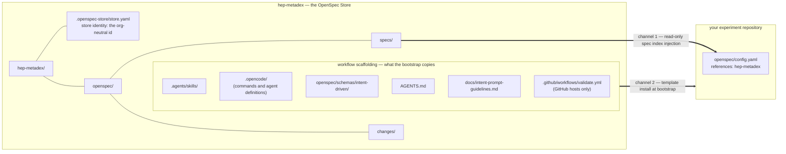

# Setup

How the hep-metadex [OpenSpec Store](../glossary/technical.md) is laid out,
and how an [experiment repository](../glossary/domain.md) connects to it.
For the shortest path, use the [README quick start](../README.md#quick-start);
this document explains each piece and covers two documented variants of that
path: adopting into an existing repository and agent-assisted bootstrap.

## The Two Channels

Content reaches an experiment repository through two independent channels
([ADR-0001](../adr/0001-serve-experiments-via-readonly-store-references.md)):

1. **Specs flow through the OpenSpec Store, read-only.** The store's
   [common capability](../glossary/domain.md) specs are never copied into
   experiment repositories. A [Store reference](../glossary/technical.md)
   declaration injects the store's [spec index](../glossary/technical.md) —
   one-line summaries plus fetch commands — into artifact workflows, and the
   agent fetches a spec with `openspec show <spec-id> --type spec --store
   hep-metadex` only when a change needs it.
2. **[Workflow scaffolding](../glossary/technical.md) flows by template
   install.** The schema, skills, commands, subagents, and agent guidance
   replicate by copying files from a hep-metadex checkout at bootstrap time —
   and, on GitHub hosts, so does the spec-validation workflow
   ([ADR-0005](../adr/0005-distribute-spec-validation-ci-as-host-conditional-scaffolding.md)).
   The store never distributes them — store references inject the spec index
   only — and experiments need the kit in their own tree regardless.



Because the channels are separate, an experiment's own specs and changes stay
in its repository, and improvements to common capability specs route to the
store explicitly via [write-back](../glossary/domain.md) (see
[usage.md](usage.md#write-back-improving-a-common-capability)).

## OpenSpec Store Layout

A store is a standalone OpenSpec repository registered per machine. The
hep-metadex store is this repository:

| Path | Role |
|------|------|
| `.openspec-store/store.yaml` | Store identity metadata: `version: 1` and the [org-neutral](../glossary/domain.md) id `hep-metadex` |
| `openspec/specs/` | The store's published [common capability](../glossary/domain.md) specifications |
| `openspec/changes/` | In-flight common-spec changes (`openspec/changes/archive/` holds completed ones) |
| `openspec/schemas/intent-driven/` | The local schema copy, part of the workflow scaffolding |
| `.agents/`, `.opencode/`, `AGENTS.md`, `docs/` | Workflow scaffolding and documentation (the template channel) |

The registered content of the store is its specs and changes — that is what
`--store hep-metadex` routes to and what a [Store reference](../glossary/technical.md)
injects.

Registration is per machine and lives outside any repository, so nothing in
an experiment repository can register the store for you. Every experiment
config declares the store's clone URL so `openspec doctor` can print a
pasteable fix on machines where the store is not registered yet:

```console
$ openspec doctor
References
  - hep-metadex: Referenced store 'hep-metadex' is not registered on this machine.
    Fix: git clone -- https://github.com/DUNE/hep-metadex.git '~/openspec/hep-metadex' && openspec store register '~/openspec/hep-metadex' --id hep-metadex
```

## Experiment Repository Configuration

An experiment repository declares its connection in its own
`openspec/config.yaml` — a read-only `references:` block naming the store by
id, with the clone URL as advisory data for the doctor fix above:

```yaml
schema: intent-driven

# Read-only connection to the hep-metadex OpenSpec Store.
# Never add a `store:` line here: this experiment's specs and changes stay
# in this repository, and common-capability improvements route to the store
# explicitly with `--store hep-metadex`.
references:
  - id: hep-metadex
    remote: https://github.com/DUNE/hep-metadex.git

context: |
  Tech stack: <your real stack — see "Adopting into an existing repository">
  We use conventional commits; every commit references its change's issue number as a (#N) subject suffix; Closes #N appears only in the archive-phase commit
  Domain: <your experiment's metadata management domain>

rules:
  proposal:
    - Must use grill-me skill
    - Must use adversarial-authoring skill
    - Must use glossary skill
  design:
    - Must use c4-diagrams skill
    - Must use glossary skill
  adr:
    - Must use architectural-decision-records skill
  specs:
    - Must use spec-as-source skill
  tasks:
    - Must use spec-as-source skill
```

The `store:` line is deliberately absent, and must stay absent: it routes
**every** artifact into the store, which would centralize the experiment's
planning ([ADR-0001](../adr/0001-serve-experiments-via-readonly-store-references.md)).
With the `references:` block instead:

- `openspec doctor` reports the store reference as ok (or prints the
  clone-and-register fix).
- Artifact workflows gain the store's spec index as read-only context.
- Changes created without `--store` land in the experiment's own
  `openspec/changes/`; `--store hep-metadex` routes a change to the store.

The `context` block is the experiment's own: describe the real domain and
tech stack, since artifact workflows read it on every stage. Stage rules
above mirror hep-metadex; comment out a rule to lighten a stage.

The [dune-metadex configuration](https://github.com/DUNE/dune-metadex/blob/main/openspec/config.yaml)
is the canonical worked example — it is the configuration the quick start was
verified against.

## Adopting into an Existing Repository

The plumbing is identical for a repository that already has code, and it is
additive: scaffolding install, config with the
[Store reference](../glossary/technical.md), doctor green — existing code and
CI untouched.

What differs is the first change. A greenfield repository starts from its
first feature; an existing repository starts **characterization-first**:

1. **Spec the seams as they behave today.** Identify the capability seams the
   coming refactor will touch, and spec each one in a change whose scenarios
   describe current behavior — agents draft from the code, humans review.
   These specs are the contract that proves the refactor changes nothing
   observable.
2. **Record the real tech stack.** Put the actual stack in `context:` and the
   acceptance stack (`stack: javascript` or `stack: python`) in
   `openspec/config.yaml`, so the acceptance tooling scaffolds the right
   runner.
3. **Scaffold the acceptance suite against the bootable application**, and
   lock in current behavior with a green suite before touching anything.
4. **Run refactor changes through the standard lifecycle**
   ([usage.md](usage.md#the-change-lifecycle)) with the suite green at every
   apply.

## Agent-Assisted Bootstrap

`/opsx-new` and `/opsx-propose` deliberately stop in repositories without an
OpenSpec root — they are change workflows, and there is nothing to attach a
change to yet. The bootstrap prompt below is the on-ramp: it gets a
repository from nothing to a connected root without writing a change.

**Machine prerequisites** (verify before pasting the prompt):

- [ ] OpenSpec CLI installed and pinned to 1.16.0 (`openspec --version`) —
      see [usage.md](usage.md#cli-version-pinning-and-upgrades) for why the
      version is pinned and how to upgrade.
- [ ] An agent harness with the `/opsx-*` lifecycle commands (OpenCode with
      the installed `.opencode/`, or the equivalent entry points for your
      tool — the CLI generates them via `openspec init --tools <tools>`).
- [ ] The hep-metadex store cloned and registered:
      `git clone https://github.com/DUNE/hep-metadex.git ~/openspec/hep-metadex`
      then `openspec store register ~/openspec/hep-metadex --id hep-metadex`
      (`openspec store list` must show it).

**Bootstrap prompt** (valid for greenfield and brownfield repositories
alike — paste it to your agent in the repository root):

```text
Bootstrap this repository onto the hep-metadex OpenSpec workflow.

First verify the prerequisites and stop with a clear report if any are missing:
- OpenSpec CLI 1.16.0 (`openspec --version`)
- The hep-metadex store registered on this machine (`openspec store list` shows
  hep-metadex and its checkout location)

Then bootstrap this repository:
1. Run `openspec init` for the agent tools this repository uses.
2. Install the workflow scaffolding from the registered hep-metadex store
   checkout: `.agents/skills/`, `.opencode/` (commands and agent
   definitions), `openspec/schemas/intent-driven/`, `AGENTS.md`, and
   `docs/intent-prompt-guidelines.md`.
3. Add spec-validation CI, conditional on this repository's host.
   - GitHub-hosted: create `.github/workflows/` if it does not exist, then
     copy `.github/workflows/validate.yml` from the registered hep-metadex
     store checkout into the same path here.
   - Hosted elsewhere: wire the equivalent gate into this repository's own
     CI — run `openspec validate --all` over all specs and changes and fail
     unless it reports `valid: true`, with the OpenSpec CLI pinned to
     1.16.0. No CI implementation is provided for other hosts.
4. Write `openspec/config.yaml` with: `schema: intent-driven`; a
   `references:` block naming the hep-metadex store id and remote
   (https://github.com/DUNE/hep-metadex.git); a `context:` block describing
   this repository's real domain and tech stack; stage rules mirroring
   hep-metadex. Do NOT add a `store:` line — this repository keeps its own
   specs and changes.
5. Iterate `openspec doctor` until it reports the hep-metadex reference as ok.

Do not create a change, and do not write any implementation code. If this
repository already has code, record its real tech stack in `context:` and
note that the first change here should be characterization-first (see
docs/setup.md in the hep-metadex store). Finish by reporting what you
installed and the final `openspec doctor` output.
```

The CI step is conditional on the host
([ADR-0005](../adr/0005-distribute-spec-validation-ci-as-host-conditional-scaffolding.md)):
GitHub-hosted repositories copy the provided workflow verbatim, while
repositories on other hosts wire the equivalent `valid: true` gate into their
own CI — the kit ships a GitHub Actions implementation only. dune-metadex
landed the workflow as [its own issue and
PR](https://github.com/DUNE/dune-metadex/pull/4) before this documentation
claimed it as a step.

The fresh-repository quick start in the README is the verified dogfood path —
those exact steps were performed on [dune-metadex](https://github.com/DUNE/dune-metadex). The existing-repository and
agent-assisted sections above are documented variants of the same plumbing,
not different mechanisms.
