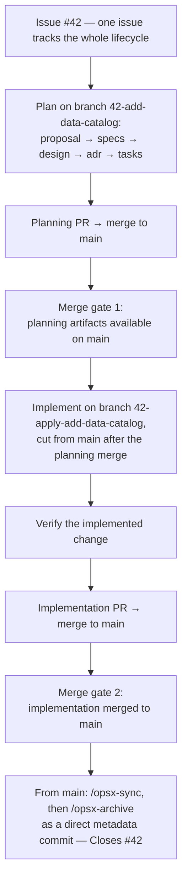

# Usage

Day-to-day work with the hep-metadex [OpenSpec Store](../glossary/technical.md):
the two flows that produce changes, the disciplines that keep them honest,
and the lifecycle every change follows. For how the pieces are installed and
connected, see [setup.md](setup.md).

## Change-Time Work (In Your Experiment Repository)

[Change-time work](../glossary/domain.md) is an experiment proposing and
implementing its own change in its own repository — with the store's
[spec index](../glossary/technical.md) injected as context.

1. **Open one issue per change.** The issue tracks the change's entire
   lifecycle, from proposal to archive.
2. **Start the change** with `/opsx-new` or `/opsx-propose` and an intent
   prompt that names the receiving actor, states observable rules, and
   declares deliverables and out-of-scope (see
   [intent-prompt-guidelines.md](intent-prompt-guidelines.md)).
3. **Plan through the intent-driven pipeline.** Artifacts land in order, each
   reviewed before the next:

   ```text
   proposal -> specs -> design -> adr -> tasks
   ```

   `openspec/config.yaml` is the source of truth for stage rules. As
   configured, each stage enforces:

   | Stage | Skills | Effect |
   |-------|--------|--------|
   | `proposal` | `grill-me`, `adversarial-authoring`, `glossary` | Interrogate the plan until shared understanding; draft via author/reviewer subagents to reduce model bias; keep terminology consistent |
   | `specs` | `spec-as-source` | Specs contain fenced Gherkin scenarios (authored with `gherkin-authoring`) that serve as the source for acceptance tests |
   | `design` | `c4-diagrams`, `glossary` | C4 architecture diagrams (ASCII or Mermaid) plus terminology consistency |
   | `adr` | `architectural-decision-records` | Durable decision records with rationale, tradeoffs, and supersession chains |
   | `tasks` | `spec-as-source` | Acceptance-test-first work: configure and run the acceptance suite, then implement |

4. **Read the injected store context.** Because the repository declares a
   [Store reference](../glossary/technical.md), artifact workflows include the
   store's spec index; cite the specs you use.

   ```text
   <referenced_stores>
   Store hep-metadex (/path/to/hep-metadex):
     - <spec-id>: <one-line summary>
     Fetch: openspec show <spec-id> --type spec --store hep-metadex
   </referenced_stores>
   ```

5. **Implement and verify** with `/opsx-apply` and `/opsx-verify`.

The `/opsx-*` commands drive the lifecycle from an agent harness:

| Command | Purpose |
|---------|---------|
| `/opsx-new` | Start a new change |
| `/opsx-propose` | Create the proposal for a change |
| `/opsx-continue` | Create the next artifact |
| `/opsx-explore` | Explore a problem or idea before committing to a change |
| `/opsx-apply` | Implement tasks from a change |
| `/opsx-verify` | Verify an implemented change |
| `/opsx-update` | Update a change's planning artifacts |
| `/opsx-sync` | Sync delta specs into main specs |
| `/opsx-archive` | Archive a completed change |
| `/opsx-bulk-apply` | Apply multiple active changes concurrently in worktrees |
| `/opsx-bulk-archive` | Archive multiple completed changes |

## Write-Back (Improving a Common Capability)

[Write-back](../glossary/domain.md) is how [common capability](../glossary/domain.md)
specs improve: any contributor, from any directory, proposes the change into
the store explicitly.

```console
$ openspec new change improve-provenance --store hep-metadex
```

- The change lands in the **store's** `openspec/changes/` — the experiment
  repository's working tree is untouched.
- From there it is ordinary store work: plan through the pipeline, open a
  pull request against the store repository, and follow
  [the change lifecycle](#the-change-lifecycle).
- Experiments pick the improvement up read-only: pull the store checkout, and
  the next artifact workflow injects the updated spec index.

## Store Pull Discipline

OpenSpec never clones, pulls, or pushes — a [Store reference](../glossary/technical.md)
reads whatever is on disk. A stale store checkout silently serves stale
specs, and `openspec doctor` checks **presence** (its pasteable fix carries
the declared remote), not freshness. So:

- **Pull the store checkout before planning work** that will cite common
  capability specs (`git -C ~/openspec/hep-metadex pull`, or wherever the
  store is registered).
- **Re-read the injected spec index at change time** — it is generated from
  the on-disk checkout at that moment.
- **After a store change merges, pull before relying on it** in the next
  experiment change.

## CLI Version Pinning and Upgrades

Both the store and experiment CI pin the OpenSpec CLI (currently
**1.16.0** — see [.github/workflows/validate.yml](../.github/workflows/validate.yml)),
because the Stores feature is **beta**: command names, flags, and file
formats may change between releases.

- **Upgrading the CLI** is a deliberate, coordinated step: install the new
  version (`openspec install` for the standalone binary, or your package
  manager), then run `openspec update` inside each project to regenerate
  agent instructions.
- **Re-read the [Stores documentation](https://openspec.dev/docs/stores)
  after upgrading** — the beta surface may have moved.
- **Revisit the validation gate** on upgrade:
  [ADR-0003](../adr/0003-fenced-gherkin-single-source-validation-gate.md)
  commits to revisiting strict-mode compatibility when a CLI release
  recognizes fenced scenarios.
- **Bump the pin in the same change** that validates the upgrade, so CI and
  contributors' machines stay aligned.

## Known Issue: Validator Warnings on Fenced Scenarios

`openspec validate` (CLI 1.16.0) recognizes only bullet-style
`- **WHEN**`/`- **THEN**` steps. This project's scenarios are authored once,
as fenced Gherkin — the single source for acceptance tests
([ADR-0003](../adr/0003-fenced-gherkin-single-source-validation-gate.md)) —
so the validator emits warnings like:

```text
⚠ [WARNING] ...: scenario "..." is missing a WHEN/GIVEN step and a THEN step.
```

These warnings are **expected noise, not failures**. The validation gate —
CI and the pre-archive check — requires `valid: true` (non-strict), which
fenced specs satisfy; every structural error still fails validation. The
acceptance toolchain enforces the same properties the warnings approximate:
extraction hard-errors on a scenario without steps, the runner fails on
pending or undefined steps, and gherkin-lint runs on the extracted features.
Strict mode becomes usable again when a CLI release recognizes fenced
scenarios.

## The Change Lifecycle

One issue per change, two merge gates, and an archive that lands on `main`
as a direct metadata commit. The example uses issue `#42` and change
`add-data-catalog`; branch names follow the `<issue>-<change>` (planning) and
`<issue>-apply-<change>` (implementation) patterns.



- **Planning** runs on `<issue>-<change>`. The planning PR carries the
  proposal, specs, design, ADRs, and tasks; it merges to `main` before any
  implementation starts.
- **Apply** cuts `<issue>-apply-<change>` from `main` after the planning
  merge, implements the tasks, and verifies. The implementation PR merges to
  `main` before anything is archived.
- **Archive** runs from `main`: sync the delta specs into the main specs,
  then archive as a direct metadata commit. That commit is the only place
  `Closes #N` appears, closing the issue that tracked the lifecycle.

Conventional commits throughout: every commit references its change's issue
number as a `(#N)` subject suffix (see
[CONTRIBUTING.md](../CONTRIBUTING.md)).

When the first change completes this lifecycle, its archived directory will
be linked here as a worked example of what a change looks like in this
repository.
