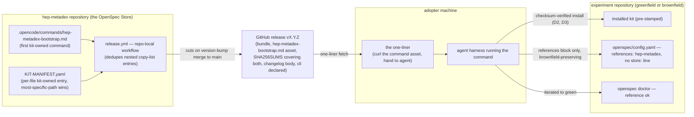

## Context

hep-metadex distributes two channels (ADR-0001): specs flow read-only through the **OpenSpec Store**; the **workflow scaffolding** — the kit — replicates by versioned, checksum-verified **Kit release** (ADR-0009), with the bump discipline enforced by the **Kit reminder** and the **Kit release gate** (ADR-0010). The documented agent-assisted bootstrap in `docs/setup.md` — machine prerequisites plus a copy-paste prompt taking an uninitialized repository to a connected one — is proven on dune-metadex but friction-heavy. This change encodes it as the `/hep-metadex-bootstrap` command, shipped in the kit and fetched by a documented one-liner when no scaffolding exists yet. The prompt remains the fallback and the specification the command automates.

Stakeholders: adopter maintainers (run the command in a greenfield or brownfield **experiment repository**), hep-metadex maintainers (ship and release the command; dogfood the archive gate), the release workflow (publishes the new asset), and the update command (#39, the consumer of the manifest's per-file ownership semantics this change introduces).

All eleven ADRs are in force (none supersedes another). This design lands procedure automation in the command layer exactly as ADR-0008 anticipated ("#9's command lands procedure automation in the command layer under this rule"), extends ADR-0009's release channel read-side (a new asset, a more granular manifest) without changing the release contract, and leaves ADR-0001's channels and ADR-0005's host-conditionality intact.

Diagram format and rigor follow the house precedent: plain Mermaid, lightweight C4-inspired container and dynamic views.

## Goals / Non-Goals

**Goals:**
- Ship `/hep-metadex-bootstrap` in the kit: agent instructions that automate the documented prompt step for step, for greenfield and brownfield repositories alike.
- Close the chicken-and-egg: a one-liner fetches the command file from the latest kit release and hands it to the agent, so an uninitialized repository needs no pre-existing scaffolding.
- Make the release carry the command as a standalone, checksummed asset derived from the same source file the bundle carries.
- Give the KIT-MANIFEST per-file ownership granularity — the kit's command is kit-owned inside the cli-owned commands directory — as the contract #39 builds against.
- Resolve the six decisions the proposal delegated to this stage.

**Non-Goals:**
- Update/sync semantics for already-bootstrapped repositories (#39), release signing (#36), spec versioning (#37), and #38's agent-free installer one-liner.
- Changing the documented prompt's procedure in substance: its five steps, their order, and their meaning stay as #34 landed them (D3 details the one mechanical fetch generalization the new asset forces).
- Any runtime installer: the command stays zero-runtime agent instructions; the kit adds no scripts and no adopter dependencies.
- Changes to the store mechanism or channel 1.

## Decisions

### D1: The command artifact — the documented prompt, step for step

`.opencode/commands/hep-metadex-bootstrap.md` carries the house command shape (frontmatter `description:`, then Steps / Output / Guardrails). Its Steps mirror the prompt's numbered steps one to one — prerequisites check, `openspec init`, kit install, host-conditional files, config authoring, doctor to green — because the prompt is the specification (the fidelity requirement makes drift a spec'd defect) and a 1:1 mapping is auditable by diff. Input is `$ARGUMENTS`: absent means the latest release; a bare semver (a leading `v` tolerated and stripped) pins the release; anything else stops with a usage report. The Output section is the final report (what was installed, the versions in play, the final doctor output); the Guardrails section carries the issue's MUST NOTs: no change created, no implementation code written, no `store:` line, no brownfield overwrite beyond the references block, stop on any prerequisite or checksum failure.

*Alternatives:* a shell script in the kit (rejected — the kit is zero-runtime and the documented path is agent-driven; a script would add a runtime surface and diverge from the prompt it automates); encoding the steps loosely with the prompt as prose backup (rejected — unauditable against the specification).

### D2: The pin check reads the release's own artifacts, before the first repository write

The prerequisites phase checks in order: `openspec --version` exists, `openspec store list` shows hep-metadex, then the release's declared CLI pin. The pin is read from the `.metadex-kit` inside the fetched, checksum-verified bundle — the same artifact about to be installed — not scraped from the release body. Ordering keeps the issue's rule literal: everything up to and including the pin comparison happens in a temporary directory; the first write to the target repository (`openspec init`) happens only after every check passes. A CLI older than the declared pin, or an unregistered store, stops the run with a report naming the missing prerequisite.

*Alternatives:* parsing the release body's "Requires OpenSpec CLI" trailer (rejected — needs `gh` or API scraping, a tool dependency the documented path does not have, and a second source for a value the bundle already carries); checking the pin only after extraction (rejected — the issue places the pin check in the prerequisites phase).

### D3: The release publishes the command as a checksummed asset; SHA256SUMS covers every asset

The release workflow gains one publication step: copy `.opencode/commands/hep-metadex-bootstrap.md` from the checkout (the same file the bundle carries — one source of truth) and publish it as the flat asset `hep-metadex-bootstrap.md` alongside the bundle. `SHA256SUMS` is generated over both assets, so an adopter can verify any fetched asset against one file. This forces one mechanical generalization in the documented manual paths (README quick start step 4, usage.md's consumption section, the prompt's kit step): fetch the assets SHA256SUMS lists — bundle and command file — then `sha256sum -c SHA256SUMS`, then extract the bundle. The step structure (fetch, verify, extract) and the prompt's five steps are unchanged in substance; this is the minimal compatibility touch the new asset requires, and it keeps the one-file `sha256sum -c` invocation from failing on the second SUMS entry. The command's own install step performs the same fetch-verify-extract, which means the run verifies every artifact it consumes.

The one-liner itself stays a single unverified fetch (`curl -fsSL -o hep-metadex-bootstrap.md .../releases/latest/download/hep-metadex-bootstrap.md`, then hand the file to the agent): folding checksum verification into it would make it a three-liner for marginal gain — the command re-fetches and verifies the asset as part of D3's flow, and signing is #36's scope.

*Alternatives:* bundle-only SHA256SUMS with an unchecksummed asset (rejected — the user-selected mechanism is checksum coverage); a second checksum file for the asset (rejected — two verification surfaces where one covers both).

### D4: Bundle assembly dedupes nested copy-list entries

The manifest's `paths:` block gains `".opencode/commands/hep-metadex-bootstrap.md": kit-owned` alongside the cli-owned directory entry. Ownership resolution takes the most specific matching path (the per-file entry wins for the command; the directory entry still governs the CLI-delivered `opsx-*` files) — but bundle assembly must not pass both entries to `tar`, which would store the file twice (and store the second occurrence as a hardlink member on GNU tar — a portability hazard for a checksum-distributed artifact). The workflow's derivation step therefore drops any entry nested inside another entry: the covering directory entry already carries the file, and the bundle's member set stays exactly the pre-change set plus the new file once. The reminder and the gate are untouched — they match paths, not bundle members, and see every entry.

*Alternatives:* accepting duplicate tar members (rejected — hardlink-member behavior varies across tar implementations); keeping the per-file entry out of `paths:` (rejected — it would lose the ownership semantics #39 consumes and break the single-source copy-list contract).

### D5: Version skew between the fetched command and the installed kit warns and proceeds

The one-liner always fetches the latest release's command file; the install may pin an older release. The skew is usually cosmetic (the command's steps are the prompt's steps, which are stable), so the command warns, proceeds, and records both versions in the final report — the fetched command's release and the installed kit's version — as an explicit input to #39. The same warn-and-proceed applies in the reverse direction (an older fetched command installing a newer kit).

*Alternatives:* refusing the pin (rejected — friction for a cosmetic skew); re-fetching the matching release's command file mid-run (rejected — the running instructions are already in the agent's context; swapping files mid-execution is stranger than the skew it fixes).

### D6: The manifest documents most-specific-path precedence where the classes live

The precedence rule is stated once in `KIT-MANIFEST.yaml`'s header comment, once in usage.md's ownership bullet (which gains the per-file exception), and once in maintainer.md's divergence-manifest rows — the same three surfaces the classes already live on. The divergence manifest gains a row for the command (the kit's first kit-owned command, inside the cli-owned commands directory) and its release-workflow row's description extends to the published asset.

### D7: setup.md gains the primary path without rewriting the section

The Agent-Assisted Bootstrap section keeps its shape and order: machine prerequisites first (they remain human-verified, and the command re-checks the two it can), then the bootstrap paths. The command becomes the primary path — the one-liner documented beside the prompt it fetches the automation for — and the prompt stays in full below it, framed as the fallback and the specification. The README quick start's existing pointer sentence (which already routes the agent-assisted variant to setup.md) gains the command; the one-liner itself lives only in setup.md so it cannot drift between documents.

### D8: Kit version 1.1.0 — a new kit component

The bump is MINOR (1.0.1 → 1.1.0) per the kit-only semver contract: a new kit component, no breaking change to installed state. The `## [1.1.0]` changelog section lands in this change; the merge cuts the release, and the archive phase runs `uv run tools/kit_release_gate.py 9` against it — the gate's first dogfood.

## The bootstrap flow

Container view — the command's channel after this change; the release now carries the command as an asset, and the manifest carries its ownership:



- Boundaries: everything left of the release is hep-metadex-internal; adopters touch only the release and the agent they already run.
- Responsibilities: the workflow owns publication (bundle, asset, checksums); the manifest owns ownership semantics; the command owns the bootstrap procedure; the prompt owns the specification.
- Key relationship: the command file has exactly one source; the asset and the bundle member are the same bytes.
- Assumptions: release assets stay fetchable unauthenticated (as today); the agent harness can read a locally saved command file.

Dynamic view — one bootstrap, from one-liner to doctor green:

```mermaid
sequenceDiagram
    participant A as adopter
    participant G as agent harness
    participant R as GitHub release
    participant X as experiment repository
    A->>A: one-liner — fetch hep-metadex-bootstrap.md from releases/latest
    A->>G: hand the file to the agent in the repository root
    G->>G: prerequisites — openspec --version, store registered
    G->>R: fetch bundle + command asset + SHA256SUMS (to temp, pinned or latest)
    G->>G: sha256sum -c; read .metadex-kit cli pin; compare with openspec --version
    G->>X: openspec init (first repository write — checks all passed)
    G->>X: extract bundle (AGENTS.md merged per merge-guidance)
    G->>X: host-conditional .github files (keep, or remove + name equivalents)
    G->>X: author openspec/config.yaml (references block; brownfield preserved)
    G->>X: iterate openspec doctor to green
    G->>A: report — installed files, versions in play, final doctor output
```

- Nothing is written to the repository before every check passes; the temp directory absorbs all fetches.
- The two stop points (prerequisites, checksum mismatch) fire before `openspec init`.

## Risks / Trade-offs

- [The one-liner's fetch is itself unverified] -> it rides HTTPS like today's quick start; the command re-fetches and verifies every artifact it consumes (D3), and signing is #36's scope.
- [Agent instructions execute only as faithfully as the agent] -> the steps mirror the prompt one to one, the prompt remains the specification, and the fidelity requirement makes drift a spec'd defect reviewable at archive time.
- [SHA256SUMS gains a second entry and old one-file verify habits break] -> every documented path is updated in the same change to fetch the listed assets first (D3); the mechanical generalization is called out so reviewers do not mistake it for a procedure change.
- [Nested copy-list entries could produce duplicate tar members] -> the workflow dedupes at assembly (D4); the bundle's member set stays the pre-change set plus the new file once.
- [Fetched command and pinned kit can skew] -> warn and proceed, both versions recorded in the report (D5); #39 consumes the recorded skew.
- [This change is the archive gate's first dogfood] -> the gate's failure output is pasteable per cause; a misfired release re-runs via `workflow_dispatch`, never a second bump (ADR-0010).
- [The prompt's hand-pinned CLI (1.16.0) and the release's declared pin diverge over time] -> sanctioned divergence (proposal, "Sanctioned divergence"): the prompt is the static fallback, the command is version-aware; both state their own pin honestly.

## Migration Plan

Ordered; each step is a conventional commit on the issue branch (`(#9)` suffix):

1. `.opencode/commands/hep-metadex-bootstrap.md` — the command (D1, D2, D5).
2. `KIT-MANIFEST.yaml` — the per-file kit-owned entry and the precedence note (D4, D6).
3. `.github/workflows/release.yml` — the command asset, two-asset SHA256SUMS, nested-entry dedupe (D3, D4).
4. Documentation: `docs/setup.md` (one-liner and command as primary path, prompt reframed), `docs/usage.md` (fetch generalization, ownership exception), `docs/maintainer.md` (divergence rows), README pointer sentence (D7); `glossary/technical.md` `Bootstrap command` term.
5. `.metadex-kit` 1.1.0 + `CHANGELOG.md` `## [1.1.0]` section (D8).
6. ADR via the adr stage; specs and tasks per the schema.
7. Merge to `main`: the release cuts v1.1.0; the archive phase then runs `uv run tools/kit_release_gate.py 9` — the first gated archive.
8. Post-merge dogfood (final task): run the one-liner and the command against a scratch repository, greenfield and brownfield variants, and confirm the report and doctor output.

Rollback: revert the change and delete the v1.1.0 tag and release if cut; everything is additive — existing installs and the documented manual path keep working with the previous release's assets.

## Open Questions

- None of the six delegated decisions remain open — D1 through D5 resolve them (pin mechanism, argument syntax, one-liner surfacing, asset derivation and checksums, nested-entry bundle assembly, skew behavior); D6 through D8 settle the manifest, documentation, and release placement.
- No in-force ADR needs revisiting: ADR-0008 routes this command to the command layer by name; ADR-0009's release contract is extended read-side only (a new asset, a more granular manifest) with the bump discipline intact; ADR-0001 and ADR-0005 are untouched. The adr stage records a new ADR, not a supersession.
- Carried, not open: acceptance sequencing (the scratch-repository dogfood) belongs to tasks; update-time reconciliation of the fetched command file belongs to #39.
