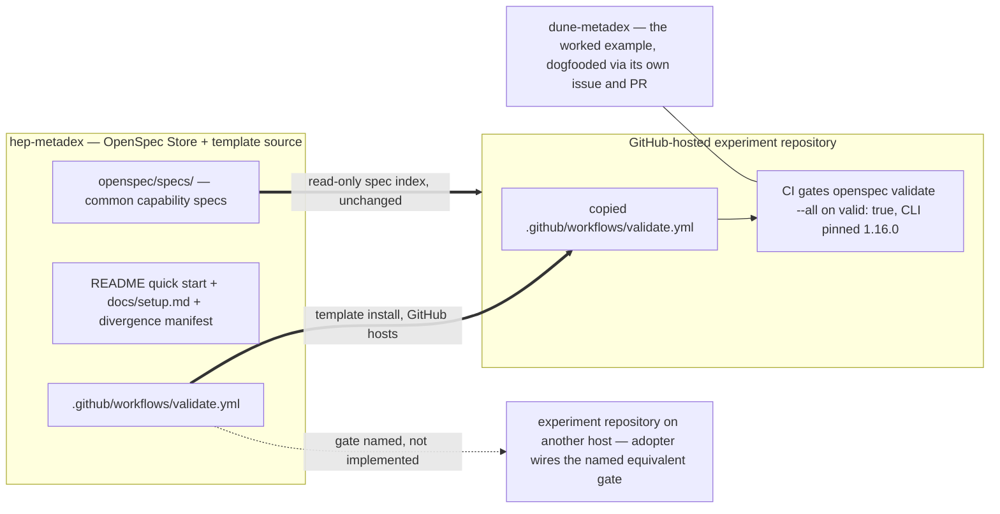

## Context

hep-metadex runs the spec-validation gate on itself: `.github/workflows/validate.yml` executes `openspec validate --all` over all specs and changes, gating on `valid: true` (non-strict) with the OpenSpec CLI pinned to v1.16.0, per ADR-0003. The bootstrap path it publishes does not distribute that gate: the README quick start and the agent-assisted bootstrap prompt install only the agent-facing pieces of **workflow scaffolding**, and the divergence manifest records the workflow as a local divergence from the intent-driven template ("the template ships no CI") rather than as something adopters receive. dune-metadex, the first adopter **experiment repository**, is live and can dogfood the missing step end to end.

In-force ADRs (verified: all four accepted, none superseded): ADR-0001 (two channels — specs read-only through the **OpenSpec Store**, **workflow scaffolding** by template install), ADR-0002 (DUNE incubation, HSF-endorsement trigger), ADR-0003 (fenced Gherkin as the single scenario source; `valid: true` non-strict gate), ADR-0004 (Apache-2.0 as a recorded divergence). This design extends the application of ADR-0001 and ADR-0003; neither is revisited.

Stakeholders: experiment teams bootstrapping an **experiment repository** (primary), store maintainers who own the bootstrap documentation and the divergence manifest, and agents executing the bootstrap prompt.

- Boundaries: the workflow file travels the template-install channel like the rest of the kit; the spec channel is untouched.
- The GitHub path copies the provided workflow verbatim; the other-host path is a named seam — the docs state the exact gate but ship nothing for it.
- dune-metadex is both an adopter and the verification instance: its PR must merge before the documentation claims the step.
- Assumption: an adopter on another host can express the gate in their own CI — it is one CLI invocation plus a version pin.

## Goals / Non-Goals

**Goals:**
- Distribute the spec-validation gate to GitHub-hosted adopters as part of **workflow scaffolding**, dogfooded first on dune-metadex via that repository's own issue and PR.
- Present the CI step as host-conditional in `docs/setup.md` and the agent-assisted bootstrap prompt; name — but do not implement — the equivalent gate for other hosts.
- Reframe the divergence-manifest entry: the workflow is distributed **workflow scaffolding** for GitHub hosts, still an intentional template divergence.
- Extend the **workflow scaffolding** glossary definition and keep the README quick start's claims verified end to end.

**Non-Goals:**
- The first **common capability** spec; a `/metadex-bootstrap` command; non-GitHub CI implementations; changes to the hep-metadex workflow itself.
- Any change to hep-metadex's own workflow file or its gate semantics (ADR-0003 stands).
- Redesigning the rest of the bootstrap path beyond inserting the CI step.

## Decisions

### D1: The validation workflow joins workflow scaffolding as a host-conditional component
`.github/workflows/validate.yml` replicates by template install (ADR-0001, channel 2): GitHub-hosted adopters copy it verbatim from the hep-metadex checkout; adopters on other hosts wire the named equivalent gate into their own CI. The divergence manifest keeps recording the file as an intentional divergence — now with its distributed role stated.

*Alternatives:* distributing through the **OpenSpec Store** (rejected — **Store reference** injection carries the **spec index** only); shipping per-host implementations (rejected — out of scope and untested by dogfooding); not distributing (rejected — the gap this change closes).

### D2: One gate, identical on both sides
dune-metadex receives the same file hep-metadex runs — `openspec validate --all` over all specs and changes, gating on `valid: true` non-strict (ADR-0003), CLI pinned to 1.16.0. No forked workflow, no adopter-specific edits: the dogfooded instance is exactly what the bootstrap step will tell future adopters to copy.

*Alternatives:* a dune-metadex-specific workflow (rejected — breaks the copy-verbatim equivalence the quick start's verified claim rests on); a strict gate (rejected per ADR-0003 — fenced scenarios fail `--strict` on CLI 1.16.0).

### D3: A distinct, host-conditional CI step immediately after the scaffolding install
The README quick start and the bootstrap prompt each gain one CI step right after the scaffolding-install step: on GitHub, copy `.github/workflows/validate.yml` from the registered store checkout; on another host, wire the named equivalent `valid: true` gate into your CI. `docs/setup.md` explains the host condition in prose where the prompt lives.

*Alternatives:* folding the copy into the existing install list (rejected — the spec contract and the dogfooding rule both speak of a CI step, and a buried list item hides the host condition from non-GitHub readers); a separate host-matrix document (rejected — one path, one document).

### D4: Cross-repo sequencing — dune-metadex's PR merges first; one hep-metadex apply PR follows
Apply runs on `12-apply-add-spec-validation-ci` cut from `main` after the planning merge. First, in the dune-metadex checkout: file that repository's own issue, cut its branch, add the workflow copied verbatim, open its PR, and get it merged. Then the hep-metadex edits land as a single implementation PR — merged only after dune-metadex's PR has merged, so the documentation never claims a step the worked example has not taken.

*Alternatives:* splitting the hep-metadex edits across PRs (rejected — every edit naming the step is a claim, so splitting doubles review surface without relaxing the ordering); landing the documentation first with an "unverified" caveat (rejected — violates the quick-start dogfooding requirement).

### D5: If the dune-metadex PR stalls or dies, the claims do not merge
While the dune-metadex PR is alive, the hep-metadex PR holds. If it is rejected or abandoned, the apply branch reverts the documentation claims (CI step, manifest reframe, glossary extension) and the CI distribution re-scopes to a follow-up change; this change merges only what remains true.

*Alternatives:* merging the documentation with a caveat (rejected — the quick start would claim an unverified step); holding this change indefinitely on another repository's review bandwidth with no exit (rejected — D5 is the exit).

### D6: The glossary extension lands with the documentation
`glossary/technical.md`'s **workflow scaffolding** definition gains the CI workflow as a GitHub-host component, edited on the apply branch in the same change as the documentation that relies on the extended sense.

## Risks / Trade-offs

- [This change's merge depends on another repository's PR] -> D4 orders the merges; D5 defines the exit; tasks.md tracks the dune-metadex issue so the dependency stays visible.
- [Copied workflows drift from hep-metadex's version over time] -> the manifest and setup.md name the file as kit; the maintainer guide's existing drift-impact rule (adopters re-run the scaffolding install when a divergence changes a copied file) covers refreshes.
- [Non-GitHub adopters get a named gate but no implementation] -> deliberate seam; the docs state the exact gate — one CLI invocation plus a version pin — so wiring it is mechanical.
- [The CLI pin ages] -> `docs/usage.md` owns pinning and upgrade guidance; the distributed workflow's pin matches hep-metadex's own and upgrades with the same discipline.

## Migration Plan

Ordered apply-phase steps, each a conventional commit (hep-metadex commits carry the `(#12)` subject suffix):

1. dune-metadex, in its own checkout: file its issue, cut its branch, copy `.github/workflows/validate.yml` verbatim from the hep-metadex checkout, commit per that repository's conventions, open its PR, merge it.
2. hep-metadex apply branch: extend the **workflow scaffolding** glossary definition.
3. `docs/setup.md`: add the host-conditional CI step to the agent-assisted bootstrap prompt and explain the host condition.
4. `docs/maintainer.md`: reframe the divergence-manifest entry as distributed **workflow scaffolding** for GitHub hosts.
5. `README.md`: add the quick start's CI step, verified by step 1.
6. Open the hep-metadex implementation PR; merge only after dune-metadex's PR has merged.

*Rollback:* dune-metadex reverts by closing its PR or reverting its merge; the hep-metadex edits revert as ordinary commits on the apply branch. Nothing touches stored specs until the archive-time sync.

## Open Questions

- **ADR granularity (adr stage decides):** does "the validation workflow is host-conditional distributed scaffolding" warrant its own ADR, or is it an application of ADR-0001 (channel 2) and ADR-0003 (the gate) that the change-local `adr.md` manifest records? No in-force ADR is superseded.
- **Acceptance automation (tasks stage decides):** the delta scenarios verify via file existence, documentation content, and CI results — no runtime application exists for a runner to boot. Whether to verify through the validation gate plus scripted checks, deferring suite scaffolding until a tech stack exists, is resolved in the tasks stage.
- **Pre-existing and out of scope:** the `governance-docs` spec's scenarios say "strict validation" where ADR-0003 gates non-strict; a separate small change should align that wording. Flagged here so it is not mistaken for this change's doing.
