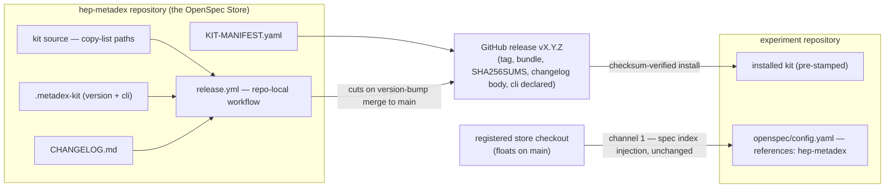

## Context

hep-metadex distributes two channels (ADR-0001): specs flow read-only through the **OpenSpec Store**; the **workflow scaffolding** — the kit — replicates by template install from a hep-metadex checkout. That checkout is unpinned, the copy leaves no provenance record, and the kit wants pinning while channel 1's checkout wants freshness; both flow from the same clone. The proposal (issue #34) gives the kit its own release identity: a semantically versioned, checksum-verified release bundle, decoupled from the store checkout.

Stakeholders: hep-metadex maintainers (cut releases, bump the version), adopter maintainers (install a pinned, verified kit into an **experiment repository**), CI (the release workflow), and the follow-on commands (#9 bootstrap, #39 update) that consume the release channel.

All eight ADRs are in force (none supersedes another). This design extends ADR-0001's channel 2 rather than revisiting it; ADR-0008's layering holds (`.github/` carries the repo-local release automation, as docs.yml already does under ADR-0007).

Diagram format and rigor follow the house precedent from the archived bootstrap change's design: plain Mermaid, lightweight C4-inspired container and dynamic views.

## Goals / Non-Goals

**Goals:**
- Give the kit version identity: a root version file that is source-side release trigger and shipped provenance stamp in one.
- Cut releases by automation: a version-bump merge to `main` produces a tag, a curated bundle, SHA256SUMS, and a changelog-sourced release body with the required OpenSpec CLI version declared.
- Make release consumption documented and verifiable: usage.md carries the manual fetch-and-verify path; the changelog is reachable from the **Documentation site**.
- Preserve channel 1 exactly: the registered checkout keeps floating on `main`; registration, **spec index** injection, and the doctor fix are untouched.
- Resolve the four decisions the issue delegated to this stage.

**Non-Goals:**
- Enforcement (#35's CI reminder and archive gate), the bootstrap and update commands (#9, #39), signing (#36), spec versioning (#37), and any installer (#38).
- Shipping the changelog or any repository documentation inside the kit bundle.
- Changing how channel 1 serves specs.

## Decisions

### D1: `.metadex-kit` — YAML, version plus CLI pin, shipped verbatim

The kit version file is `.metadex-kit` at the repository root, YAML:

```yaml
version: 1.0.0
cli: 1.16.0
```

`version` is the kit's semver; `cli` is the OpenSpec CLI version the kit requires — one file is the single source for both the release trigger and the per-release CLI declaration. The file ships verbatim in the bundle; the install path appends nothing. Install-side metadata (date, source URL) is deliberately excluded: an appended stamp would diverge from the source file and break the verbatim fast-forward that a future update (#39) depends on. Provenance beyond the version lives in the GitHub release and changelog, not in the file.

*Alternatives:* a bare `1.0.0` text file (rejected — the CLI declaration would need a second source); appending install metadata at install time (rejected — breaks verbatim shipping).

### D2: One curated tarball, checksums as a sibling asset

Each release publishes `metadex-kit-<version>.tar.gz` — the kit tree at its natural repository paths (the copy-list, now including `.metadex-kit` and `KIT-MANIFEST.yaml`) — plus `SHA256SUMS` covering the bundle. The bundle is the contract; GitHub's auto-generated source archives are full-repo snapshots and are not it. The versioned filename means cached downloads never collide across releases.

### D3: Changelog entries land as version headings in the bump change

There is no `[Unreleased]` section: a kit-altering change always releases (the bump merge cuts the release), and a non-kit change never does, so nothing ever accumulates unreleased. The bump change writes the `## [X.Y.Z] - YYYY-MM-DD` heading with its date as known at preparation; the GitHub release's own timestamp is authoritative, and a date that drifts after a delayed merge is cosmetic and correctable in any later change. Entries use Keep a Changelog categories (Added / Changed / Fixed / Removed) and reference their change issue in the house `(#N)` style. The version file's `cli:` pin must agree with `validate.yml`'s `OPENSPEC_VERSION`; the release workflow cross-checks the two and fails on mismatch, so the two pin surfaces cannot drift silently.

### D4: The changelog is link-reached, not site-published

Docs pages link `../CHANGELOG.md`; `tools/docs_site.py` rewrites the link to the GitHub blob URL on the published site (the same machinery the glossary links use). No staged copy, no build changes, no drift risk. Revisit only if evaluators ask for the changelog in site navigation.

### D5: Release workflow — bash, git, and gh only, on push to main

`.github/workflows/release.yml` is repo-local (never kit), named and structured like its siblings (`validate.yml`, `docs.yml`). The DUNE organization's Actions policy permits only GitHub-created, DUNE-owned, or allowlisted actions — `astral-sh/setup-uv` already startup-fails under it — so the workflow uses `actions/checkout` plus the runner's preinstalled `git` and `gh` CLI; no third-party release actions.

- **Trigger:** push to `main` (plus `workflow_dispatch` as the first-release and re-run fallback).
- **Bump detection:** diff `.metadex-kit` against the latest `v*` tag; a changed version is the bump. No prior tag existing counts as a bump — the version file's *introduction* is v1.0.0's trigger, which is how the workflow's own landing cuts the first release.
- **Gate:** extract the `## [X.Y.Z]` section from `CHANGELOG.md`; fail without publishing if it is missing. Cross-check `cli:` against `validate.yml` (D3).
- **Publish:** tag the merge commit `vX.Y.Z` (`contents: write` permission), assemble the bundle (D2), generate `SHA256SUMS`, and `gh release create` with the extracted section as the body and the CLI requirement declared.
- **Footprint:** tags and releases only — never commits on `main` — and no release-please-style PR generation anywhere.

### D6: Ownership classes govern overwrite behavior; the copy-list governs bundle membership

The reviewer knot from the proposal council is resolved by separation: the bundle contains every copy-list path — CLI-owned ones included, because a bootstrap installs into an empty repository and needs the whole kit — while ownership classes say what may *overwrite* what in an existing install: CLI-owned paths refresh through `openspec update`, never a kit copy; merge-guidance (`AGENTS.md`) is merged, never overwritten; never-touch (`openspec/config.yaml`) is neither bundled nor written. `KIT-MANIFEST.yaml` (repo root, YAML) maps each copy-list path to its class and refresh route; #39 consumes it as its reconciliation contract.

### D7: The copy-list grows, and the docs re-point

The documented copy-list (README quick start step 4) adds `.metadex-kit` and `KIT-MANIFEST.yaml`, so the documented path lands the stamp. Steps 4–5 re-point from the store checkout to the release bundle (fetch, verify against SHA256SUMS, extract, copy); setup.md's two-channels section, layout table, and bootstrap prompt follow; maintainer.md gains divergence-manifest rows for the version file (new kit file) and the release workflow (repo-local, never kit) plus a release-process section; usage.md gains release consumption with the manual checksum verification. Step 2 — clone and register the store — is unchanged: channel 1 still needs the checkout; only the kit's source moves.

## The release channel

Container view — the two channels after this change; the kit gains a versioned path to adopters while the store checkout keeps floating:



- Boundaries: the release channel (channel 2) is fully inside hep-metadex until the GitHub release; adopters consume only the release, never the workflow.
- Responsibilities: the workflow owns tag/bundle/checksum/publication; the version file owns identity; the changelog owns the release body; the manifest owns overwrite semantics.
- Key relationship: `release.yml` reads `.metadex-kit` and `CHANGELOG.md` and produces the release; the checkout-to-config edge (channel 1) is untouched by every step.
- Assumptions: GitHub releases remain available to unauthenticated fetches (asset redirects are not API-rate-limited); the DUNE action policy stays as documented in docs.yml.

Dynamic view — one release, from merge to published:

```mermaid
sequenceDiagram
    participant M as maintainer
    participant G as main
    participant W as release workflow
    participant R as GitHub release
    M->>G: merge change (kit files, .metadex-kit bump, CHANGELOG entry)
    G->>W: push trigger
    W->>W: diff .metadex-kit vs latest v* tag (introduction counts as a bump)
    W->>W: extract CHANGELOG [X.Y.Z] section; fail if missing
    W->>W: cross-check cli: pin against validate.yml; fail on mismatch
    W->>W: assemble bundle + SHA256SUMS
    W->>R: tag vX.Y.Z; create release (body = changelog section, CLI declared)
```

- The workflow never writes back: its last act is the release; `main`'s history gains nothing.
- The two failure gates (missing section, pin mismatch) fire before any artifact is published.

## Risks / Trade-offs

- [The workflow's first-ever run is triggered by the merge that introduces it] -> `workflow_dispatch` fallback plus a first-release acceptance task; v1.0.0 can be re-cut manually with the same inputs if the run misfires.
- [Changelog heading dates can drift from the actual merge date] -> the GitHub release timestamp is authoritative; the drift is cosmetic and fixable in any later change.
- [DUNE's Actions policy blocks third-party release actions] -> the workflow uses only `actions/checkout` plus preinstalled `git`/`gh`; the constraint is recorded in the workflow comments, as docs.yml already does.
- [Two CLI-pin surfaces (`.metadex-kit` `cli:` and `validate.yml`) could drift] -> the release workflow cross-checks them and fails the release on mismatch (D3).
- [Tar bundles are not byte-reproducible across builds] -> each release publishes its own SHA256SUMS next to the artifact it describes; determinism is not a requirement at this scale.
- [Ownership-class semantics are defined now but consumed only by #39] -> the manifest documents refresh routes today; the specs make the classes observable; #39 builds against a published contract, not a promise.

## Migration Plan

Ordered; each step is a conventional commit on the issue branch (`(#34)` suffix):

1. `.metadex-kit` (version 1.0.0, cli 1.16.0), `CHANGELOG.md` with its `## [1.0.0]` section, `KIT-MANIFEST.yaml`.
2. `.github/workflows/release.yml` (repo-local).
3. Documentation: README quick start steps 4–5, setup.md (two-channels, layout table, bootstrap prompt), maintainer.md (manifest rows, release process), usage.md (release consumption, changelog link).
4. ADR-0009 via the adr stage.
5. Merge to `main`: the workflow cuts v1.0.0 on the introducing merge — the explicit first-release acceptance focus, with `workflow_dispatch` as fallback.
6. Post-merge dogfood (final task): re-run the kit install on dune-metadex from the v1.0.0 release; the first adopter gains its provenance stamp.

Rollback: delete the tag and release, revert the change; existing installs are untouched (everything is additive; the kit's installed content is unchanged by this change).

## Open Questions

- None of the four delegated decisions remain open — D1 through D4 resolve them (name/format, packaging, changelog mechanics, site reachability).
- No in-force ADR needs revisiting: ADR-0009 extends ADR-0001's channel 2 (source refinement) and leaves ADR-0005's host-conditionality and ADR-0008's layering intact; the adr stage records this as a new ADR, not a supersession.
- Carried, not open: first-release verification sequencing belongs to tasks (step 5 above); enforcement of the bump discipline belongs to #35.
