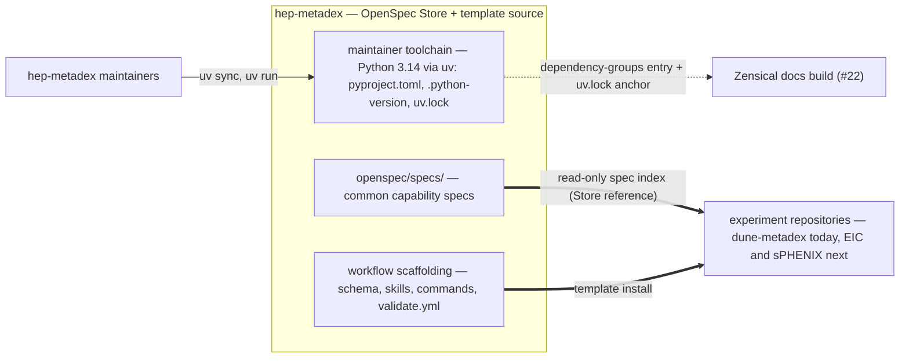

## Context

hep-metadex is a zero-runtime specification repository: an **OpenSpec Store** publishing **common capability** specs that **experiment repositories** consume read-only, plus a **workflow scaffolding** kit that replicates by template install. Its tooling story is currently a declared absence — `openspec/config.yaml`'s `context` block opens with `Tech stack: TBD`, and `docs/hsf-affiliation.md`'s "General information" row claims the stack is TBD by design until the first runtime change. The work ahead needs the absence gone: #22 stands up the Zensical docs build, and future utility scripts need a pinned interpreter, while the acceptance suite deliberately stays unscaffolded until a runnable target exists (#20).

In-force ADRs (verified: all five accepted, none superseded): ADR-0001 (two channels — specs read-only through the **OpenSpec Store**, **workflow scaffolding** by template install), ADR-0002 (DUNE incubation, HSF-endorsement trigger; governance text stays **org-neutral**), ADR-0003 (fenced Gherkin as the single scenario source; `valid: true` non-strict gate), ADR-0004 (Apache-2.0 as a recorded divergence), ADR-0005 (host-conditional scaffolding; the divergence manifest is the reconciliation discipline). This design is coherent with all five and revisits none: the **maintainer toolchain** sits outside both of ADR-0001's channels, the governance rewrite stays **org-neutral**, and the validation gate is untouched.

Stakeholders: hep-metadex maintainers (the toolchain's only actors), #22's future docs build (the first consumer of the scaffolding), and HSF evaluators reading the affiliation checklist.

- Boundaries: the **maintainer toolchain** has no edge to **experiment repositories** — it flows through neither of ADR-0001's channels; both existing channels are unchanged.
- Responsibilities: uv owns the interpreter pin, the project file, and the lockfile; maintainers are its only actors, and adopting repositories are asked to install nothing new.
- Key relationship: #22 is the first consumer — Zensical lands in the `[dependency-groups]` the scaffolding reserves, and its CI can lean on the committed `uv.lock`.
- Assumption: uv's lockfile is the reproducibility anchor without pinning uv itself; #22's CI (which installs uv explicitly) is the natural point to revisit.
- The toolchain is C4 context-level only: it has no containers or components — it is three files and a manager — so deeper levels would add nothing.

## Goals / Non-Goals

**Goals:**
- Establish a pinned, reproducible **maintainer toolchain** (Python 3.14 via uv) with a bare project shape honest to the repository's zero-runtime reality.
- Retire every "TBD" claim about the tech stack — in the injected `context` block and the HSF affiliation checklist — while the repository stays zero-runtime.
- Record the boundary in the places future maintainers and agents read: the divergence manifest, the README repository map, and the **maintainer toolchain** glossary term.
- Leave the acceptance `stack:` key unset, with the deferral recorded where the adr stage decides (ADR-0006).

**Non-Goals:**
- The Zensical docs build, its CI, and any Pages publishing (#22).
- Acceptance-test scaffolding or the acceptance `stack:` declaration (#20's trigger).
- Any change to the **workflow scaffolding** kit, the vendored skills, the published specs, or the validation gate.
- Any toolchain expectation — stated or implied — for **experiment repositories**.

## Decisions

### D1: The maintainer toolchain is repo-local — a non-channel
Content reaches **experiment repositories** through exactly two channels (ADR-0001): specs read-only through the **OpenSpec Store**, kit by template install. The **maintainer toolchain** deliberately travels neither: `pyproject.toml`, `.python-version`, and `uv.lock` exist to maintain hep-metadex itself and are absent from the README step-4 copy list. The **maintainer toolchain** glossary term encodes the boundary so prose can say "this repository's own tooling" without implying an adopter mandate.

*Alternatives:* adding the toolchain files to the kit (rejected — every adopter would inherit a Python expectation the store's mandate says they choose for themselves); declaring a family-wide stack (rejected — the store is adopter-autonomous by design); leaving the stack TBD (rejected — #22 and future tooling need a pinned base, and the TBD claim is already false the moment maintainers adopt any tooling).

### D2: Bare project shape — `[project]` only, pinned 3.14, committed lockfile
`pyproject.toml` carries `[project]` with `name = "hep-metadex"`, a `version`, and `requires-python = ">=3.14"`; no build system, no package scaffolding, no `src/`. `.python-version` pins `3.14` (resolving to the installed 3.14.x; the major-minor pin lets uv absorb patch releases). `uv.lock` is committed — it is what makes a clean clone's `uv sync` reproducible and what #22's CI will check against. `.gitignore` gains `.venv/`, extending the minimal local file. Dev tooling lands in uv's `[dependency-groups]`, introduced empty and reserved for #22's Zensical.

*Alternatives:* a packaged project (`uv init` default — rejected: it implies a distributable runtime package the repository does not have); `uv init --virtual` with no pyproject (rejected — `uv add --dev zensical` in #22 would have nowhere to land); pinning 3.12, the system interpreter (rejected — 3.14 is installed via uv, matches the Zensical documentation's example, and gives a longer runway); pip with `requirements.txt` (rejected — uv is the chosen manager and the lockfile is the reproducibility story).

### D3: uv is unpinned; the lockfile is the compatibility anchor
The OpenSpec CLI is pinned because its validator's behavior is the gate (ADR-0003); uv is a self-updating tool whose lockfile format carries the compatibility contract — a sync against a too-old uv fails loudly with the required version stated. No uv version appears in documentation for now.

*Alternatives:* documenting a minimum uv version (rejected — ceremony without a dogfooded failure mode; the installed 0.13.x has no known floor issue); pinning uv in a config file (rejected — revisit at #22, where CI installs uv explicitly and a pin is testable rather than decorative).

### D4: The `context` line states the toolchain and its boundary
`openspec/config.yaml`'s `context` block replaces `Tech stack: TBD` with a line carrying what every future artifact workflow needs: language and version (Python 3.14), manager (uv), and the boundary (repo-local **maintainer toolchain**, zero-runtime, no adopter mandate). The line must not declare an acceptance stack — the `stack:` key stays unset per the proposal, and the deferral is recorded by the adr stage.

*Alternatives:* a multi-line tech-stack section (rejected — the context block is injected wholesale into every artifact prompt; one dense line keeps that payload small); naming the expected acceptance default in the context line (rejected — the boundary between "declared" and "deferred" belongs in ADR-0006, not in an always-injected prompt where it would read as settled).

### D5: The HSF affiliation row declares the toolchain without breaking its mapping
`docs/hsf-affiliation.md`'s "General information" row currently claims "the single tool dependency is the OpenSpec CLI … the tech stack is TBD by design until the first runtime change." The rewrite names the **maintainer toolchain** (Python 3.14 via uv, pinned interpreter, no runtime code) while preserving the row's two load-bearing claims for its audience: the repository map describes the layout, and adopters' tool dependency is unchanged — the OpenSpec CLI, pinned 1.16.0. The `governance-docs` spec's requirement — that the checklist maps every required guideline to a satisfying artifact — is unaffected: the mapping survives, only the row's content updates. The wording stays **org-neutral** (ADR-0002).

*Alternatives:* rewriting the row to claim a runtime stack (rejected — false; the repository is zero-runtime); moving the toolchain mention to the "Test suite" row (rejected — that row's deferred-coverage story is correct as-is, per #20).

### D6: Three artifacts carry the same boundary message
The divergence manifest gains one combined "Not installed" row — `pyproject.toml`, `uv.lock`, `.python-version` as **maintainer toolchain** files outside the install guide's file list, mirroring the existing `package.json` row's semantics (not added during a template sync without a deliberate decision) — and the existing `.gitignore` row's reason updates to "Only `openspec/.cache/` and `.venv/` are needed so far." The README repository map gains one row pointing at the toolchain files as maintainer-side tooling, explicitly not part of what adopters copy. Together with the glossary term (landed with the proposal), a future maintainer meets the same boundary statement in the manifest, the map, and the vocabulary.

*Alternatives:* one manifest row per file (rejected — the manifest's own precedent is a single combined row for `package.json`/`package-lock.json`/`skills-lock.json`); extending an existing manifest row instead of adding one (rejected — the template-sync semantics differ: those files are template files not installed, these are local files the template never ships).

## Risks / Trade-offs

- [The 3.14 pin ages as Python releases cadence] -> the pin is major-minor, so uv absorbs patch releases automatically; a minor bump is a one-line `.python-version` edit plus `uv sync` and a lockfile commit, and the design states the procedure so it needs no new decision.
- [A future uv lock format requires a newer uv than a maintainer has] -> `uv sync` fails loudly with the required version; #22's CI installs uv explicitly and will make any floor visible; revisit D3 there.
- [The hsf-affiliation rewrite drifts from the `governance-docs` spec's mapping requirement] -> the requirement constrains the mapping's existence, not the row's content; the archive-time validation gate (`valid: true`) plus review of the row against the guideline list covers it.
- [Future maintainers mistake the toolchain files for kit] -> three artifacts carry the boundary (manifest row, README map row, glossary term), and the files' absence from the step-4 copy list is the mechanical guard.
- [Editing `openspec/config.yaml` touches the specs zone] -> the BDD zone rules apply at apply time: the config edit is its own single-zone commit, sequenced so no code-zone work is uncommitted alongside it.

## Migration Plan

Ordered apply-phase steps, each a conventional commit carrying the `(#21)` subject suffix, each single-zone per the BDD zone rules:

1. `chore(toolchain): add uv scaffolding with the Python 3.14 pin (#21)` — create `pyproject.toml`, `.python-version`, extend `.gitignore` with `.venv/`, run `uv sync` to generate `uv.lock`, verify `uv run python -V` reports 3.14.x. (code zone)
2. `docs(openspec): replace tech stack TBD with the maintainer toolchain (#21)` — rewrite the `context` line per D4. (specs zone; committed before any code-zone work begins)
3. `docs(governance): rewrite the general-information row for the declared toolchain (#21)` — the hsf-affiliation rewrite per D5. (code zone)
4. `docs(maintainer): record the maintainer toolchain divergence rows (#21)` — manifest row plus `.gitignore` row-reason update per D6. (code zone)
5. `docs(readme): note the maintainer toolchain in the repository map (#21)` — the map row per D6. (code zone)
6. Verification: from a clean clone, `uv sync` succeeds and `uv run python -V` reports the pinned version; `openspec validate --all` remains `valid: true`.

*Rollback:* every step reverts as an ordinary commit; reverting step 1 removes the toolchain entirely. No stored specs are touched by this change (`skip_specs`), so archive has no spec sync to unwind.

## Open Questions

- **ADR granularity (adr stage decides):** ADR-0006's exact scope — one ADR covering the toolchain decision with the `stack:` deferral recorded as a consequence, as the proposal assumes. No in-force ADR is superseded; ADR-0001 is clarified (the toolchain is explicitly outside both channels), not amended.
- **uv pinning policy (revisit at #22):** whether #22's CI pins uv via its setup step. Until a CI installs uv explicitly, the lockfile is the anchor and no documented floor exists (D3).
- **Zensical integration specifics belong to #22:** the `dependency-groups` entry, `zensical.toml`, the build workflow, and Pages publishing are #22's design, not this one's; this design only reserves the landing zone.
