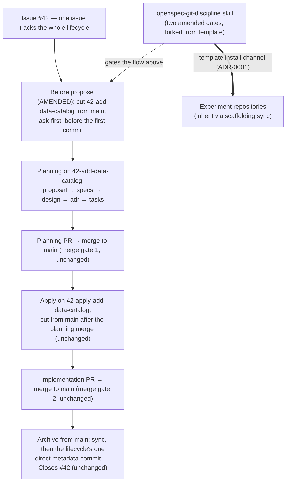

## Context

The `openspec-git-discipline` skill gates where OpenSpec change work lands, but its "Before propose" gate still says *Prefer `main`; if not, warn and ask whether to continue intentionally* — permission for a change's first commits to land directly on `main`, with the branch only offered after propose (*offer to create a PR branch for review*). Practice has already moved: `17-align-bootstrap-prompt-ci-step` (PR #18), `21-adopt-python-uv-toolchain`, and this change's own branch `24-require-issue-branch-for-changes` follow the issue-number-first slug, and `docs/usage.md`'s lifecycle section documents the `<issue>-<change>` (planning) and `<issue>-apply-<change>` (implementation) patterns. `CONTRIBUTING.md`'s pull-request section says only "Branch from `main`" with no naming rule. The skill ships in the **workflow scaffolding** every **experiment repository** installs, so the gate text replicates to adopters on their next scaffolding sync (ADR-0001, channel 2).

In-force ADRs (verified: all seven accepted, none superseded): ADR-0001 (two channels — specs read-only through the **OpenSpec Store**, **workflow scaffolding** by template install) carries the forked skill outward; ADR-0003 (fenced Gherkin as the single scenario source, `valid: true` non-strict gate) governs this change's delta-spec format; ADR-0004 (divergences recorded) and ADR-0005 (kit-distribution precedent) shape the manifest row. No in-force ADR is revisited.

Stakeholders: contributors and agents running propose/continue/apply workflows (primary — their change commits must land on the issue branch before reaching `main` by merge); store maintainers who own `docs/maintainer.md` and the vendored skills; adopting **experiment repositories**, which inherit the amended gates.

- Boundaries: the issue branch is cut **before any commit exists**; everything downstream — planning merge, apply branch, implementation merge, archive — is unchanged, and the archive metadata commit remains the lifecycle's one direct commit on `main` (bookkeeping, not change work).
- The amended gates live in the skill, which travels the template-install channel to adopters — the change's only outward-facing consequence.
- Assumption: the issue number exists before propose, guaranteed by CONTRIBUTING's "Every Change Starts as an Issue" rule, so `<issue-number>-<change-slug>` is always computable at the gate.
- The two amended gates replace preference with policy; the no-auto-git consent rule is the safety valve on every git action the gates name.

## Goals / Non-Goals

**Goals:**
- Amend exactly two gates in `.agents/skills/openspec-git-discipline/SKILL.md` — "Before propose" cuts the **issue branch** from `main` before the change's first commit (ask-first); "After propose" offers the planning PR from the branch that already exists.
- Record the skill edit as a vendored-skill fork: a divergence-manifest row plus a drift-impact entry with the hand-merge/re-apply recovery procedure.
- Carry the naming rule to every surface a contributor or agent already reads: `CONTRIBUTING.md`'s pull-request section, `AGENTS.md` (one line), and the **issue branch** glossary term in `glossary/technical.md`.

**Non-Goals:**
- No change to the core rule, phase sequence, apply gate, archive gate, Required Checks, or Red Flags — the recommended workflow stands; `docs/usage.md` needs no edits.
- No automated enforcement (CI branch-name checks, hooks) — the policy is agent-gate and contributor-document discipline; tooling is a possible follow-up change.
- No repo-level ADR: a contributor-workflow policy recorded on three durable surfaces (skill, CONTRIBUTING, spec) follows the glossary-fork precedent; the change-local `adr.md` records the review.
- No adopter-notification mechanism; adopters inherit on their next scaffolding sync, per the manifest's existing experiment-repositories rule.

## Decisions

### D1: "Before propose" gate — exact replacement wording
Replace the row with: *Cut the change's issue branch `<issue-number>-<change-slug>` from `main` before its first commit (ask-first; on decline, warn and ask whether to continue intentionally).*

*Alternatives:* silent auto-cut (rejected — violates the no-auto-git rule the issue requires intact); a softened "prefer the issue branch" (rejected — preference is exactly the loophole the issue closes); posing an open question with no default (rejected — a gate states policy; the decline path already exists).

### D2: "After propose" gate — exact replacement wording
Replace the row with: *Ask the user to commit proposal artifacts on the issue branch; offer to open the planning PR from the branch that already exists.*

*Alternatives:* keep "offer to create a PR branch" (rejected — the branch now exists by policy; offering another forks the work); auto-opening the PR (rejected — no-auto-git).

### D3: The skill edit touches exactly two gate rows
The Core Rule, "During continue", "Before apply", "Before archive", "After archive", Required Checks, and Red Flags are untouched.

*Alternatives:* adding a Red Flags entry for direct-to-main change commits (rejected — the list catches cross-gate process violations, not every gate's negation, and the issue's scope is deliberately narrow); rewording the Core Rule to mention branches (rejected — explicitly out of scope: the core rule must not change).

### D4: Divergence-manifest row mirroring the glossary-fork row
Add to the Intentional Divergences table: Area `.agents/skills/openspec-git-discipline/`; Divergence: the "Before propose" and "After propose" gates amended to require the `<issue-number>-<change-slug>` issue branch cut from `main` before a change's first commit; Reason: standing policy that change work reaches `main` only by pull-request merge — **this is a fork of a vendored skill** (the glossary row's fork marker, reused).

*Alternatives:* folding this into the existing glossary row (rejected — different directory, different recovery steps); recording it in the README (rejected — the manifest has lived in `docs/maintainer.md` since the documentation-set reorganization).

### D5: Drift impact as a second vendored-skill-fork bullet
Add a bullet parallel to the glossary fork's: a template sync that overwrites `.agents/skills/openspec-git-discipline/` silently reverts the two amended gates; recover by hand-merging upstream changes into the skill and re-applying the two amended gates.

*Alternatives:* generalizing the single existing bullet to cover all vendored forks (rejected — per-fork bullets keep each recovery procedure specific and greppable); relying on "Updating From Upstream" step 4 alone (rejected — the issue demands a drift-impact entry, and step 4's parenthetical examples are illustrative, not exhaustive).

### D6: CONTRIBUTING gains the naming rule with an apply-pattern pointer
The pull-request bullet becomes: *Branch from `main` as `<issue-number>-<change-slug>` — cut before the change's first commit — open the PR against `main`, and keep the change lifecycle…* with a parenthetical noting that implementation branches follow the documented `<issue>-apply-<change>` pattern (`docs/usage.md`).

*Alternatives:* adding the apply pattern as a second full rule (rejected — `docs/usage.md` owns the lifecycle; CONTRIBUTING gains only the naming rule the issue names); no clarifying pointer (rejected — a contributor would misname their apply branch `42-add-data-catalog` instead of `42-apply-add-data-catalog`).

### D7: AGENTS.md gains a fourth bullet, not an amendment of the skill bullet
*Every new change cuts an `<issue-number>-<change-slug>` branch from `main` before its first commit; change work reaches `main` only by pull-request merge — enforced by the openspec-git-discipline skill.*

*Alternatives:* appending to the existing openspec-git-discipline bullet (rejected — each rule stays atomic and independently diffable; the existing bullet is about when to load the skill, this one is the convention itself).

### D8: The glossary term is scoped to planning and implementation commits
`glossary/technical.md` gains **issue branch**: the `<issue-number>-<change-slug>` branch cut from `main` before a change's first commit, whose pull-request merge carries the change's planning and implementation work to `main`. Use when: referring to where a change's work lands before its PR merge. Avoid: confusing with the apply-phase branch `<issue>-apply-<change>`, or with the archive phase's direct metadata commit on `main`. The scoping is load-bearing: an unscoped "only way commits reach `main`" would contradict the preserved archive commit.

## Risks / Trade-offs

- [Adopters inherit the amended gates only on their next scaffolding sync] -> the manifest row names the fork; adopter refreshes already follow the manifest's experiment-repositories rule (re-run the scaffolding install when a divergence changes a copied file).
- [A naive template sync silently reverts the gates] -> D5's drift-impact bullet states the recovery; `openspec validate` catches structural damage only, so the sync procedure's diff review is the real guard.
- [No automated enforcement of branch naming] -> deliberate; the spec's scenarios verify content (gate rows, manifest, docs), and discipline is enforced by the agent gate plus review. A CI branch-name check is a candidate follow-up change.
- [Agents that never load the skill miss the gate] -> D7's AGENTS.md pointer surfaces the convention in every session; still soft — review catches violations.
- [Ask-first friction: users decline out of habit] -> the decline path degrades gracefully to today's status quo (warn and ask whether to continue intentionally) rather than blocking the workflow.

## Migration Plan

Planning (this change) lands as specs-zone commits on `24-require-issue-branch-for-changes`, merged before apply starts. Apply runs on `24-apply-require-issue-branch-for-changes` cut from `main` after the planning merge; every edit is code-zone (outside `openspec/`), so each group is its own conventional commit with the `(#24)` suffix:

1. Amend the two gate rows in `.agents/skills/openspec-git-discipline/SKILL.md` (D1, D2).
2. Add the divergence-manifest row and the drift-impact bullet in `docs/maintainer.md` (D4, D5).
3. Extend `CONTRIBUTING.md`'s pull-request bullet (D6).
4. Add the `AGENTS.md` bullet (D7).
5. Add the **issue branch** term to `glossary/technical.md` (D8).
6. Verify: `openspec validate require-issue-branch-for-changes --type change` reports `valid: true` (non-strict per ADR-0003); scripted sweeps confirm both gate rows, the manifest row, the drift bullet, the CONTRIBUTING sentence, the AGENTS.md bullet, and the glossary term; the issue's five rules are checked one by one.

*Rollback:* revert the apply-branch commits; nothing touches stored specs until the archive-time sync.

## Open Questions

- **ADR granularity (adr stage decides):** the amendment is a contributor-workflow policy recorded on three durable surfaces (skill gates, CONTRIBUTING, spec) — per the glossary-fork precedent it does not warrant a repo-level ADR; the change-local `adr.md` manifest records the review. No in-force ADR is superseded.
- **Acceptance automation (tasks stage decides):** no runnable target exists for an acceptance runner to boot, and the acceptance `stack:` key deliberately stays unset until one does — scenarios verify as content-rubric checks (validation gate plus scripted sweeps), mirroring the uv-toolchain change's verification approach.
