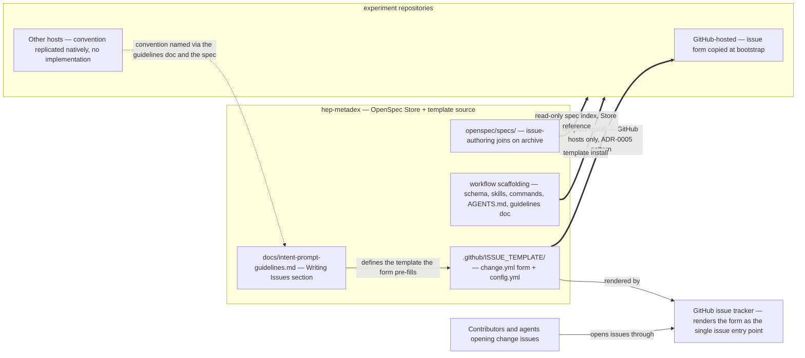

## Context

hep-metadex is a zero-runtime specification repository: an **OpenSpec Store** publishing **common capability** specs that **experiment repositories** consume read-only, plus a **workflow scaffolding** kit that replicates by template install. Its issue-authoring convention currently lives only in practice: the open issues were reformatted onto the **intent material** template (#8, #9, #19, #20; #21 and #22 were drafted in it), but no form, doc, or spec records it — `docs/intent-prompt-guidelines.md` defines the *intent prompt* given to `/opsx-new` or `/opsx-propose`, not the issue body that feeds it, and `.github/` carries only the two workflows (`validate.yml`, `docs.yml`). Every change starts as an issue that anchors its whole lifecycle — its **issue branch**, its `(#N)` commit trail, its archive close — so a drifting issue format degrades every downstream artifact.

In-force ADRs (verified: all seven accepted, none superseded): ADR-0001 (two channels — specs read-only through the **OpenSpec Store**, **workflow scaffolding** by template install), ADR-0002 (governance text stays **org-neutral**), ADR-0003 (fenced Gherkin as the single scenario source; `valid: true` non-strict gate), ADR-0004 (Apache-2.0 as a recorded divergence; manifest discipline), ADR-0005 (host-conditional scaffolding — GitHub-hosted adopters copy the provided file, other hosts get the named convention; the divergence manifest is the reconciliation), ADR-0006 (repo-local **maintainer toolchain** — irrelevant here, no runtime code), ADR-0007 (Zensical docs site built from `docs/` in place with a strict link gate). This design is coherent with all seven and revisits none: the issue form is a second instance of ADR-0005's host-conditional pattern — the extension its consequences explicitly anticipate ("a future host guide extends the kit the same way — dogfooded first").

One spec boundary needs an explicit reading: the docs-site spec's "Documentation paths and scaffolding untouched" requirement is scoped to the change that delivered it (#22 — its scenario reads "as delivered by this change"); its standing content pins `docs/intent-prompt-guidelines.md` at its current path, which this change honors by adding a section without moving the file. That this change edits kit files at all follows change #24's precedent: **workflow scaffolding** evolves through the normal change lifecycle; the docs-site requirement froze the *path*, not the content.

Stakeholders: contributors and agents opening issues in hep-metadex (the form's direct users), GitHub-hosted adopters (the form's distribution targets), and future change authors everywhere (the routing-rule ADR's readers).

- Boundaries: the form is a GitHub-host artifact inside the kit; it rides channel 2 (template install) like every other kit file, but only GitHub hosts can render it — the host-conditional edge is the same shape as validate.yml's.
- Responsibilities: the guidelines doc defines the host-neutral template; the form is this repository's GitHub implementation of it; the spec (on archive) carries the requirement into every connected **experiment repository**'s artifact workflows through the **spec index**.
- Key relationship: an issue's **intent material** pastes directly as the `/opsx-new` or `/opsx-propose` prompt — the form's field order matches the issue-body order the open issues already use, so no rewriting happens at the boundary.
- Assumption: GitHub issue forms (YAML) are stable enough to ship as kit; the form is one file plus one config line, trivially revertible if GitHub's form schema shifts.
- Context-level only: there are no containers or components — the change is two YAML files, prose, and an ADR; deeper C4 levels would add nothing.

## Goals / Non-Goals

**Goals:**
- Make the **intent material** template discoverable and enforced at the issue tracker: one form carrying the six required sections plus the optional labeled sections, with the blank-issue path disabled.
- Document the template where authors already read — a "Writing Issues" section in `docs/intent-prompt-guidelines.md` — and route both human and agent authors to it through existing pointers (CONTRIBUTING.md, AGENTS.md), with no new authoring skill.
- Distribute the form to adopters exactly as validate.yml distributes: one host-conditional copy-list item, a divergence-manifest row, and a dogfooded claim on dune-metadex.
- Record the kit-layering routing rule and the intent-driven schema-fork trigger conditions as a durable ADR, referenced from the maintainer guide and CONTRIBUTING.md.

**Non-Goals:**
- Forking the intent-driven schema (`openspec schema fork`); the ADR records the fork *trigger conditions* instead.
- Any new authoring skill; agent guidance flows through the extended AGENTS.md → guidelines-doc pointer.
- The `/metadex-bootstrap` command (#9 stays its own change — but this change extends the manual copy-list that #9 will later automate).
- Retrofitting closed issues; the template governs new issues only.
- The Python/uv toolchain (#21) and the Zensical site (#22).

## Decisions

### D1: One change form — six required fields, one optional catch-all
`.github/ISSUE_TEMPLATE/change.yml` uses GitHub's YAML issue-form schema: six required textareas in issue-body order — Context, Suggested change name, Actor, Deliverables, Rules, Out of scope — plus one optional free-form textarea for the labeled optional sections (Gate, Trigger, Decisions inside the change, Provenance, References). The field order matches the issue-body order the reformatted issues already use, so a submitted body is ready-to-paste **intent material** with no rearrangement. The form sets no issue labels: label taxonomy stays a maintainer act, not a form artifact.

*Alternatives:* all eleven sections as separate fields (rejected — a five-field-longer form for sections most issues don't use; GitHub renders required and optional identically, so the optional five would add noise to every issue); six required fields only (rejected — the optional sections are proven in practice — #9's Gate, #20's Trigger, #8's References — and a catch-all field gives them a sanctioned home instead of the author improvising).

### D2: Blank issues disabled; config stays minimal
`.github/ISSUE_TEMPLATE/config.yml` sets `blank_issues_enabled: false` and nothing else — no contact links, no extra templates. The form becomes the single entry point, which is honest to this repository's contribution model: one issue per change, and the issue tracker is the change tracker.

*Alternatives:* keeping blank issues (rejected — the escape hatch is exactly where drift re-enters; the issue explicitly recommends disabling); contact links pointing at discussions or maintainers (rejected — no discussion forum is part of this repository's workflow today; adding one is a separate decision).

### D3: The form ships as one host-conditional copy-list item
The kit copy-list gains `.github/ISSUE_TEMPLATE/` — the form and its config together, one item — and it joins the *host-conditional* group, not the unconditional step-4 list: GitHub's form schema runs only on GitHub. The README quick start's step 5 ("Add spec-validation CI, conditional on your host") widens to cover both host-conditional files — spec-validation CI and the issue form — with the copy commands for each; `docs/setup.md`'s agent-assisted bootstrap prompt extends its CI step the same way (GitHub-hosted: copy both; other hosts: both conventions named, nothing implemented); the two-channels diagram gains the issue form beside validate.yml as a GitHub-hosts-only kit node. One step, one host-conditional concept — the ADR-0005 pattern generalized to "the host-conditional kit files".

*Alternatives:* a separate quick-start step for the form (rejected — fragments a single concept across two steps and renumbers every later step); adding the form to the unconditional step-4 list (rejected — it would instruct non-GitHub adopters to copy a file their host cannot render, breaking the named-not-implemented promise); shipping only `change.yml` without `config.yml` (rejected — adopters would get the form but keep blank issues, losing the single-entry-point policy downstream).

### D4: The quick-start claim waits for the dune-metadex dogfood
The in-force adopter-onboarding requirement already binds the quick start: it "MUST claim a bootstrap step only once the worked example, dune-metadex, has verified it." That clause is general — a bootstrap step — so the issue-form step inherits it exactly as the CI step did. dune-metadex installs `.github/ISSUE_TEMPLATE/` through its own issue and PR (the validate.yml precedent: dune-metadex#4), and the README claims the step only once that lands. The delta spec's MODIFIED quick-start requirement extends the exemplar to name both host-conditional items, and its new scenario mirrors "The claimed CI step is verified on the worked example".

*Alternatives:* claiming the step without the worked example (rejected — violates the standing MUST and ADR-0005's dogfood-first decision); landing the dune-metadex change from this repository (rejected — cross-repository work happens through that repository's own issue tracker; this change coordinates, it does not push).

### D5: "Writing Issues" lands in the guidelines doc, after the Template section
`docs/intent-prompt-guidelines.md` gains a "Writing Issues" section directly after its existing "Template" section — lifecycle order: the issue precedes the prompt it feeds. The section defines the six required sections with the same load-bearing framing the prompt template uses, then the five optional labeled sections with one-line use-when guidance each (Gate: a precondition that must hold before the change starts; Trigger: the condition that activates a deferred change; Decisions inside the change: choices deliberately delegated to the change; Provenance: where the idea was previously recorded; References: links to related artifacts), and closes by noting that the GitHub form pre-fills the sections with blank issues disabled, while repositories on other hosts replicate the convention natively. The document stays at its current path — pinned by the docs-site spec and the kit copy-list.

*Alternatives:* a separate `docs/issue-guidelines.md` (rejected — the issue template and the intent prompt are one authoring continuum; two documents would drift apart and the copy-list would grow a file); placing the section before the intro (rejected — the doc's actor-boundary explanation serves both issues and prompts; the template sections belong together); documenting the optional sections inside the form's field descriptions only (rejected — GitHub truncates long field descriptions in some clients, and non-GitHub adopters read the guidelines doc, not the YAML).

### D6: Pointers ride existing surfaces — no new skill
CONTRIBUTING.md's "Every Change Starts as an Issue" section gains a sentence pointing to the form and the Writing Issues guidance; its "Where Decisions Live" section gains the routing-rule reference (D7). AGENTS.md's existing guidelines-doc pointer — currently scoped to intent prompts for `/opsx-new` and `/opsx-propose` — extends to cover issues opened by agents, so an agent session that has read AGENTS.md follows the template without loading any skill. The **intent material** glossary entry (landed with this proposal, per the glossary skill and the #21 precedent) gives every surface one term to link.

*Alternatives:* a new authoring skill (rejected — the issue explicitly rules it out; AGENTS.md → guidelines-doc is the established routing); embedding the full template in AGENTS.md (rejected — AGENTS.md is pointer-shaped by design; the guidelines doc is the copy-listed home of authoring guidance).

### D7: The routing rule lands as one durable ADR, referenced from two surfaces
The kit-layering routing rule — schema for artifact structure inside changes, `openspec/config.yaml` rules for per-stage discipline, skills for agent-triggered discipline, commands for procedure automation, the intent-prompt guidelines doc for authoring guidance, `.github/` for host-conditional automation — is recorded as one durable ADR under `adr/` at the next sequence number (0008 today; the number is confirmed at this change's adr stage). The ADR also records the intent-driven schema-fork trigger conditions: structural artifact changes upstream will not take, the schema declares companion skills, or upstream stalls. `docs/maintainer.md`'s Repository Configuration section — which already maps skills, commands, and config to their roles — references the ADR, and CONTRIBUTING.md's "Where Decisions Live" section references it for contributors deciding where a new convention belongs. The ADR generalizes ADR-0005's pattern without superseding it: ADR-0005 decided the CI workflow's distribution; this ADR decides the layering rule that placed the issue form in `.github/` by the same logic.

*Alternatives:* recording the routing rule in the guidelines doc or maintainer guide as prose (rejected — it is architecture that constrains every future convention, and ADRs are the durable, review-bar-backed home for exactly that; prose in guides has no supersession chain); superseding ADR-0005 (rejected — its decision stands unchanged; the routing rule is a sibling generalization, not a replacement); separate ADRs for the routing rule and the fork triggers (rejected — the triggers are the rule's pressure valve; splitting them would leave the rule with no recorded escape conditions).

### D8: The divergence-manifest row mirrors validate.yml's framing
`docs/maintainer.md`'s "Intentional Divergences" table gains one row for `.github/ISSUE_TEMPLATE/`: the issue form and its config are kit the template never ships, distributed host-conditionally so GitHub-hosted adopters copy them at bootstrap, with the change's issue and the routing-rule ADR cited. One row for the directory, not two — the form and its config are one distribution unit (D3), and the manifest's own precedent is one row per divergence, however many files it names (`package.json`/`package-lock.json`/`skills-lock.json` share a row).

*Alternatives:* one row per file (rejected — the manifest's precedent is semantic rows, not file rows); extending the validate.yml row to cover "host-conditional kit files" generally (rejected — that row records the CI workflow's divergence and its ADR-0005 reason; the issue form's row carries its own reason and its own ADR cross-reference).

## Risks / Trade-offs

- [Disabling blank issues removes the escape hatch for non-change reports] -> the repository's only issue mode is one-issue-per-change (CONTRIBUTING); if a genuine second issue type emerges, a second form is the natural extension and `config.yml` is a one-line revert. Recorded as an accepted trade-off, per the grill decision.
- [Copied forms drift from the source until adopters re-run the scaffolding install] -> identical to validate.yml's drift exposure; the divergence-manifest row plus the manifest's drift-impact discipline is the reconciliation, and adopters re-running the install pick up the current form.
- [The dune-metadex dogfood stalls this change] -> the install is two small files through dune-metadex's own issue and PR (the validate.yml precedent, dune-metadex#4); every other deliverable is independent of the claim, so a stalled dogfood delays only the README/setup copy-list step, not the form, the guidance, or the ADR.
- [GitHub-form mechanics leak into host-neutral statements] -> the spec states the convention host-neutrally and names the form as this repository's implementation; the guidelines define the template, not the YAML; the non-GitHub bootstrap step names the convention without shipping an implementation. New copy stays **org-neutral** (ADR-0002).
- [New cross-references break the strict docs build] -> the Writing Issues section and the new pointers use the repository's existing relative-link conventions; `zensical build --strict` gates every pull request (ADR-0007), so a broken link or anchor fails CI before merge.
- [ADR-0008's sequence number collides with a concurrent ADR-bearing change] -> no other active change exists; the file was created at this change's adr stage, and every reference cites it by file path, so a hypothetical renumber is a path edit in exactly two reference sites plus the manifest row.
- [Zone discipline at apply time] -> all implementation files are code zone; the specs-zone delta files land with the planning merge before apply starts, so no apply-phase unit of work mixes zones. The **intent material** glossary entry and ADR-0008 are the code-zone edits made during propose (glossary skill and adr stage, the #21 precedent) and commit separately from the specs-zone planning artifacts.

## Migration Plan

Ordered apply-phase steps, each a conventional commit carrying the `(#23)` subject suffix, each single-zone per the BDD zone rules (all are code zone):

0. *Cross-repo coordination, not a commit:* dune-metadex opens its own issue and PR installing `.github/ISSUE_TEMPLATE/` — the precondition for step 5's quick-start claim (D4).
1. `feat(issues): add the intent-material change form and disable blank issues (#23)` — create `.github/ISSUE_TEMPLATE/change.yml` (D1) and `.github/ISSUE_TEMPLATE/config.yml` (D2).
2. `docs(guidelines): define the intent-material template in Writing Issues (#23)` — the guidelines section per D5; `zensical build --strict` stays green.
3. `docs(contributing): point the issue policy and decisions sections at the template and routing rule (#23)` — the two CONTRIBUTING.md pointers per D6, citing ADR-0008 (created at this change's adr stage).
4. `docs(agents): extend the guidelines pointer to issue authoring (#23)` — the AGENTS.md pointer extension per D6.
5. `docs(readme): add the issue form to the host-conditional bootstrap steps (#23)` — README quick start and `docs/setup.md` (prompt, prose, and diagram) per D3, merged only once step 0 has landed.
6. `docs(maintainer): record the issue-form divergence and routing-rule reference (#23)` — the manifest row (D8) and the Repository Configuration reference (D7).

*Rollback:* every step reverts as an ordinary commit; reverting step 1 removes the form entirely (GitHub's default blank-issue behavior returns). The propose-phase code-zone edits — the **intent material** glossary entry and ADR-0008 — revert with the planning PR if the change is abandoned before apply. No stored specs are touched outside this change's own deltas, so archive is a routine sync.

## Open Questions

- **ADR granularity (adr stage decides):** one ADR covering both the routing rule and the fork trigger conditions, as the proposal and D7 assume. No in-force ADR is superseded; ADR-0005 is generalized, not amended.
- **ADR sequence number:** 0008 today (no other active change carries an ADR); confirmed at the adr stage before any file or reference is written.
- **Form field prose (apply detail):** each field's `description` and `placeholder` text — D1 fixes the fields and their order; the microcopy is written against the guidelines section at apply time so the two never diverge.
