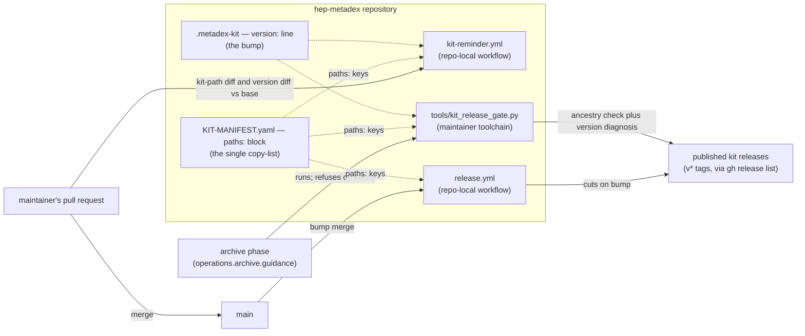
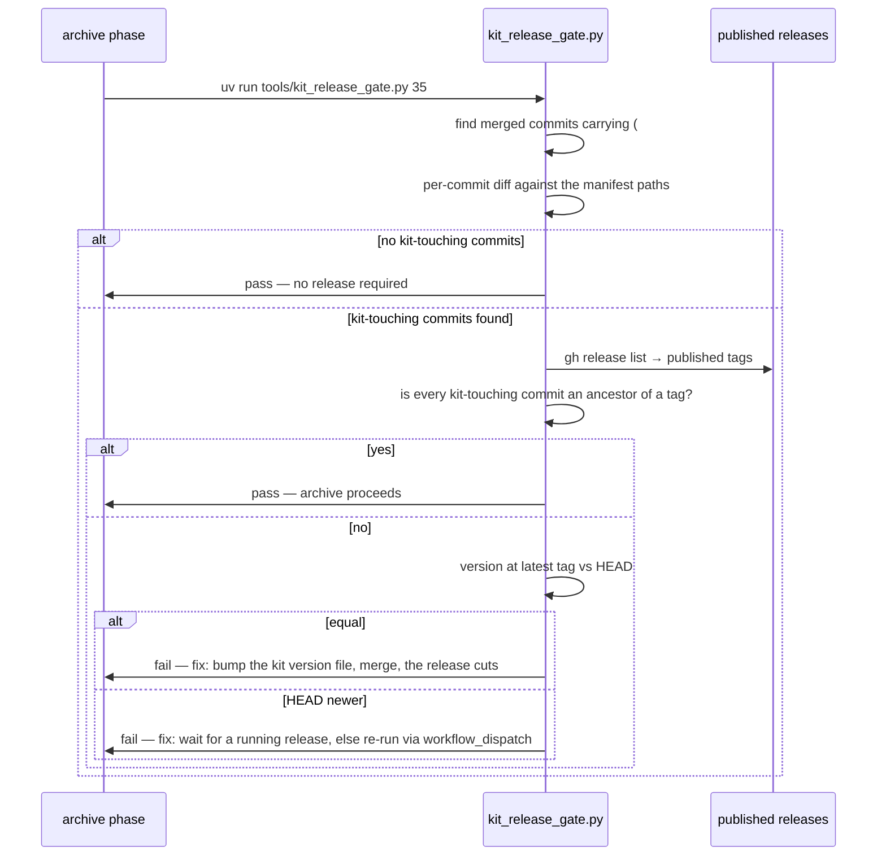

## Context

#34 landed the versioned **Kit release** channel: the bump-in-the-same-change rule carries the release discipline by convention, the release workflow cuts a release when a bump merge lands, and the maintainer guide documents the discipline. Two seams remain unenforced: a change can alter kit files and forget the bump — silent at review time — and a change could complete its lifecycle with kit changes that no published release contains. The proposal (issue #35, whose **Intent material** is the authoritative request) mechanizes the discipline: an advisory reminder at review time and an archive-phase gate as the backstop.

Stakeholders: hep-metadex maintainers (review pull requests, archive changes), the archive-phase agent workflow (runs the gate), CI (the reminder and release workflows), and #9 (add-metadex-bootstrap-command) — the next kit-touching change and the gate's first substantive dogfood.

All nine ADRs are in force (none supersedes another). This design extends ADR-0008's routing — the config-rules layer carries the gate wiring, `.github/` carries the reminder, repo-local tooling carries the script — and touches ADR-0009's release mechanism read-side only: bundle assembly derives from the manifest instead of an inlined list, with the bundle itself unchanged. No supersession is proposed; the adr stage records ADR-0010.

The grilled decisions constrain this design: the gate is a repo-local script wired through `openspec/config.yaml`'s `operations.archive.guidance` (never the kit-owned skill), the reminder is a repo-local advisory CI workflow, and this change touches zero kit paths — no bump, no changelog entry, no release — keeping #9 as the first substantive dogfood.

Diagram format and rigor follow the house precedent from the archived designs: plain Mermaid, lightweight C4-inspired container and dynamic views.

## Goals / Non-Goals

**Goals:**
- Catch the forgotten bump at review time with an advisory that never blocks merge — mechanically or visually.
- Block the archive of a kit-touching change until a published release contains its kit changes, printing a pasteable fix that names the right remedy for the diagnosed cause.
- Single-source the kit copy-list: the release workflow, the reminder, and the gate all read the `KIT-MANIFEST.yaml` `paths:` block, with the release bundle byte-identical.
- Document both mechanisms in the maintainer guide's release-process section and record both artifacts in the divergence manifest.
- Touch zero kit paths, so this change carries no version bump and cuts no release; the gate's own archive run is its trivially-green smoke test.
- Resolve every decision the proposal deferred to this stage.

**Non-Goals:**
- New release mechanics (owned by #34); promoting the reminder to a required status check (parked unless misses recur); enforcement inside any **Experiment repository**.
- Mechanically preventing an archive that skips the gate — the gate is archive-process discipline, not prevention.
- Release signing (#36), the bootstrap command (#9), the update command (#39), and installer automation (#38).

## Decisions

### D1: Reminder surface — always-green check, PR comment plus log warning

The reminder workflow exits 0 in every outcome; a nonzero exit renders a red X on the pull request even without branch protection, violating the never-blocking rule. On detection it posts two surfaces: a `::warning::` annotation (visible in the pull request's annotations area) and a PR comment via `gh pr comment --edit-last` — creating on first post, editing thereafter — so the advisory is durable in the timeline without stacking one comment per push. The workflow authenticates with its own `github.token`; `gh` is preinstalled on the runner.

*Alternatives:* annotation only (rejected — log annotations are easy to miss and give the maintainer no durable thread to reply to); a failing check (rejected — a red X is exactly the visual block the issue forbids); creating dedicated check runs through the API (rejected — more machinery for no added visibility).

### D2: Reminder detection semantics

Kit paths are the `paths:` keys of `KIT-MANIFEST.yaml` — directory entries match their subtrees, so a new file under `.agents/skills/` counts. The workflow triggers on `pull_request` (opened, synchronize) and diffs the head against the pull request's base: a kit change is any changed path under a manifest path; a corresponding bump is a changed `version:` value in the **Kit version file** between base and head — a `cli:` pin change alone is not a bump. The advisory fires on kit-change-without-bump; a version-only diff draws no advisory (whether a content-less bump should release is release mechanics, out of scope). The manifest's quoted `paths:` keys are extracted with awk — the same dependency-free style release.yml already uses for `.metadex-kit` fields.

### D3: Gate containment semantics — lineage, not tree equality

"A published **Kit release** contains those changes" means the release was cut at or after the change's kit-affecting merges. `uv run tools/kit_release_gate.py <issue-number>` decides it:

1. Finds the change's merged commits on `main` by the conventional-commit subject suffix `(#N)` — greppable because every commit of the change carries it.
2. Diffs each commit against its parent, restricted to manifest paths, collecting the kit-touching commits — per-commit diffs, so commits from other changes interleaved on `main` cannot pollute the set.
3. Requires every kit-touching commit to be an ancestor of a tag belonging to a *published* release — tags come from `gh release list`, not `git tag`, so a manually pushed tag with no release does not satisfy the gate.
4. Passes without consulting releases when the change has no kit-touching commits — the zero-kit-path case, including this change's own archive.

Diagnosis picks the fix: compare the `version:` value at the latest release tag with `HEAD`. Equal → forgotten bump → the fix is the issue's text: bump the **Kit version file**, merge, and the release cuts. `HEAD` newer → a bump merged but nothing published → the release run misfired or is still in flight → the fix says wait for a running release, otherwise re-run via `workflow_dispatch` — never a second bump, which would scope the release wrong.

*Alternatives:* tree-equality of kit paths between the latest tag and `HEAD` (rejected — any later change's kit edits would false-block this change's archive); checking only the latest tag (rejected — misses multi-increment changes whose earlier increments released but whose later ones did not); a CI check the archive phase consults (rejected in the grill — async and CI-dependent where a local script performs the identical check synchronously).

### D4: Gate wiring — config guidance, never the kit-owned skill

One line joins `operations.archive.guidance` beside the OpenSpec Sync rule: run the kit release gate before archiving and refuse on failure. The archive workflow already carries config guidance into its procedure, so the gate runs at every archive with zero kit files touched. The gate's hardness lives in the spec'd process — the observable rule is that the archive workflow runs the gate and refuses on failure — and the guidance line makes the run part of the archive procedure itself.

*Alternatives:* amending `.agents/skills/openspec-git-discipline/` (rejected — kit-owned; the gate would ship into every adopter's kit copy, brushing the out-of-scope rule, and the change would become kit-touching, self-dogfooding the gate it introduces and contradicting the issue's progression); a CI check the archive phase consults (rejected — see D3).

### D5: Single-source copy-list — the manifest paths block, three native parsers

The `KIT-MANIFEST.yaml` `paths:` block is the single copy-list definition — its header already claims exactly that. release.yml's inlined tar list is replaced by derivation: awk extracts the quoted keys in manifest order, which equals today's inline order, so the bundle's member list is unchanged and the bundle stays byte-identical (tasks verify by comparing tar listings of the derived and inline assembly over the same tree). The reminder (D2) and the gate (D3) parse the same keys with their native tooling — awk in the workflows, Python in the gate — so a copy-list change reaches all three consumers by construction.

*Alternatives:* a shared parser script all three call (rejected — a runtime dependency in the release path to save two small parsers over a stable, repo-owned format; the workflows stay bash and awk); the lighter read-only convergence — mechanisms read the manifest, release.yml keeps its inline list (rejected — manifest-vs-inline drift would stay invisible until a release ships wrong); restructuring the manifest for machine parsing (rejected — it would edit a kit-owned file and break this change's no-bump story; the quoted-key format parses fine).

### D6: Divergence-manifest placement

The reminder workflow gets its own row, the release.yml pattern: repo-local maintainer automation, never part of the **Workflow scaffolding**, citing ADR-0010. The gate script gets a new row of its own citing the **Maintainer toolchain** (ADR-0006's pattern) and ADR-0010, rather than joining the existing `tools/` row — that row's reason is the documentation site specifically (ADR-0007), and broadening it would misattribute the gate to the docs-site decision.

## The enforcement loop

Container view — both mechanisms inside hep-metadex, all three copy-list consumers reading one definition:

- Boundaries: everything is repo-local maintainer automation; nothing ships in the kit, and no **Experiment repository** sees either mechanism.
- Responsibilities: the manifest owns the copy-list; the version file owns bump identity; the reminder owns review-time visibility; the gate owns archive-time containment; the release workflow owns publication.
- Key relationship: all three kit-path consumers — reminder, gate, release workflow — derive their path set from the one `paths:` block, so no consumer can drift from the others.
- Assumptions: the conventional-commit `(#N)` suffix reliably marks a change's commits on `main`; `gh release list` enumerates the published releases the gate consults.

Dynamic view — the gate at archive time, including both failure diagnoses:

- The gate's first branch is this change's own archive: zero kit-touching commits, trivial pass.
- Both failure exits print a pasteable fix; only the diagnosis differs — a second bump is never advised for a misfire.

## Risks / Trade-offs

- [A guidance-wired gate is process discipline; nothing mechanically prevents an archive that skips it] -> the spec makes "the archive workflow runs the gate and refuses on failure" the observable rule, the maintainer guide documents the gate as part of the archive procedure, and #9's archive exercises it for real.
- [The release.yml derivation edits the repository's most critical automation for zero observable change] -> bundle equivalence is a tasks-level verification (tar listings compared over the same tree); the derivation preserves manifest order, which equals today's inline order; rollback is reverting the workflow edit alone.
- [Three parsers over one manifest could disagree] -> the format is repo-owned and stable; the gate's test suite verifies its parsed set against the manifest keys; the reminder's detection uses the same extraction; a copy-list change reaching all three consumers is a spec scenario.
- [The reminder's comment could stack across pushes] -> edit-last semantics keep one advisory per pull request.
- [The diagnosis can misread an in-flight release as a misfire] -> the misfire fix's first instruction is to wait for a running release; `workflow_dispatch` is the fallback, and a re-run is harmless — the release workflow's gates re-check everything.
- [The gate first runs for real at this change's own archive, before any true failure has occurred] -> the trivial pass is exactly the spec's zero-kit-path scenario; the first failure-path exercise is #9's archive, where the pasteable fix is the recovery path.

## Migration Plan

Ordered; each step is a conventional commit on the **Issue branch** `35-enforce-kit-release-discipline` (`(#35)` subject suffix):

1. Single-source derivation in release.yml; the reminder workflow `.github/workflows/kit-reminder.yml` (D1, D2, D5).
2. The gate script `tools/kit_release_gate.py` with its test suite, test-first (D3).
3. The `operations.archive.guidance` line in `openspec/config.yaml` (D4).
4. Documentation: maintainer.md's Kit Releases section gains both mechanisms; divergence-manifest rows per D6; glossary entries for the coined terms (house precedent: an apply-phase tasks line).
5. ADR-0010 via the adr stage.
6. Merge to `main`: no release fires (zero kit paths); the reminder runs green on the planning and apply pull requests with nothing to advise.
7. At archive: the gate's first run — trivially green over zero kit paths; the archive-phase commit carries `Closes #35`.

Rollback: revert the change — the mechanisms are additive repo-local automation with no kit state and no release involvement; existing releases and installs are untouched.

## Open Questions

- None of the proposal's deferred decisions remain open — D1 through D6 resolve them: the advisory surface, the detection semantics, the containment semantics, the gate's CLI shape and name, the manifest derivation with its equivalence verification, and the divergence-manifest placement.
- No in-force ADR needs revisiting: ADR-0009's release mechanism is extended read-side (bundle assembly derives from the manifest) without changing its observable contract, and ADR-0008's routing holds — config rules for the gate wiring, `.github/` for the reminder, repo-local tooling for the script. The adr stage records ADR-0010 as a new decision, not a supersession.
- Carried, not open: the reminder comment's exact wording and the guidance line's exact phrasing are tasks-level detail; observing the reminder fire and the gate pass on a real kit-touching change belongs to #9's own verification, not this change's.
