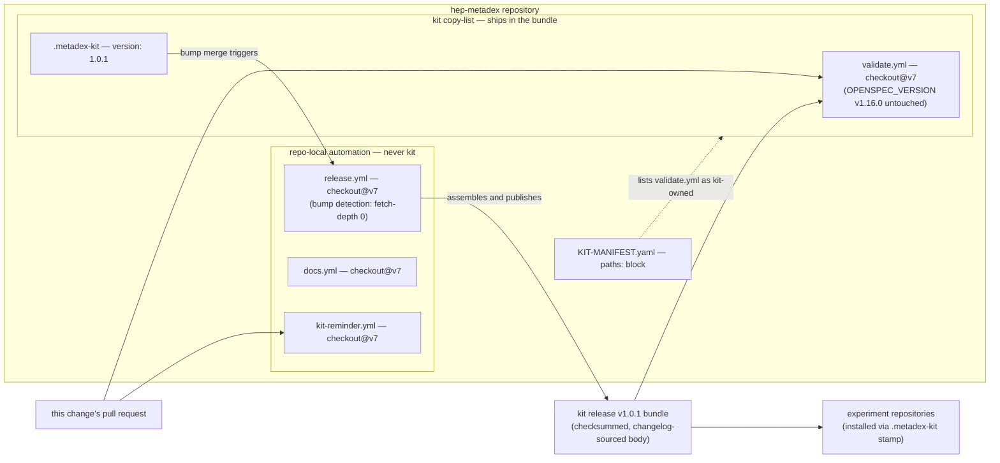
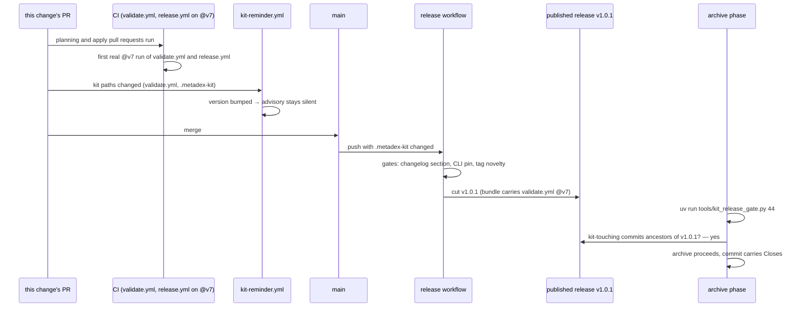

## Context

The repository's four GitHub Actions workflows pin `actions/checkout` two ways: `docs.yml` and `kit-reminder.yml` — the two newest — pin `@v7` (#22 and #35 set the precedent), while `release.yml` and `validate.yml` still pin `@v4`, never revisited after the newer workflows landed. The split is drift, not decision, and it is not static: `@v4` is a floating major tag that already moved under the older workflows (v4.4.0, July 2026, carrying the same fork-checkout security backport as the v7 line), so the "old" pin keeps changing unreviewed. The proposal (issue #44, whose **Intent material** is the authoritative request) unifies all four at one major and, because `.github/workflows/validate.yml` is a kit copy-list path, carries the kit release discipline in the same change.

Stakeholders: hep-metadex maintainers (review the pin move, cut and consume the release), the repository's CI (all four workflows re-run on this change's own pull requests), **experiment repositories** that install the **workflow scaffolding** (the updated `validate.yml` ships to them in the next **Kit release**), and the archive-phase agent workflow (runs the **Kit release gate**).

All ten ADRs are in force (none supersedes another). This design touches their seams without moving any: ADR-0005 distributes `validate.yml` as host-conditional scaffolding — the pin move reaches adopters through exactly that channel; ADR-0009's release mechanism runs as designed on the bump; ADR-0010's reminder and gate observe this change from their posts; ADR-0008's routing is untouched (`.github/` automation stays where it is). No supersession is proposed; the adr stage records ADR-0011.

Planning resolved the open choices: the capability is `workflow-action-pinning` (user-confirmed) and the target major is `@v7` — the issue's expected direction, confirmed by the investigation below.

## Goals / Non-Goals

**Goals:**
- One unified `actions/checkout` pin at `@v7` across all four workflows, with the two already there verified rather than assumed.
- Carry the kit release discipline in the same change: PATCH bump of the **Kit version file** plus the matching `CHANGELOG.md` section, so **Kit release** v1.0.1 cuts automatically on merge.
- Record the target-major decision and its one adopter-facing consequence durably, in ADR-0011.
- Keep the diff minimal: pin lines only — no workflow logic, no new enforcement, no documentation edits.

**Non-Goals:**
- SHA or exact-version pinning — out of scope per the issue; floating-major is the repository's established pattern and lets security backports arrive automatically.
- Any enforcement mechanism for the unified-pin invariant (#35 owns the enforcement machinery as a category; this change adds none).
- The OpenSpec CLI pin (`OPENSPEC_VERSION`) and its cross-check — explicitly out of scope and untouched.
- Re-evaluating the DUNE organization's Actions policy — applied as-is.
- Documentation changes — no doc or divergence-manifest row references the checkout pins today.

## Decisions

### D1: Target major `@v7` — the investigation found no constraint

The issue left the target open to this change's own investigation; it closes in favor of `@v7`:

- v7.0.0's behavior change (June 2026) refuses fork pull request checkouts under `pull_request_target` and `workflow_run` events unless opted out. None of the four workflows uses those events — they trigger on push, pull_request, and workflow_dispatch — so the change cannot fire here. `kit-reminder.yml` runs on plain `pull_request`, which is unaffected, fork or not.
- `fetch-depth: 0` fetches full history and tags identically across v4 through v7, so `release.yml`'s tag-based bump detection (diff `.metadex-kit` against the latest `v*` tag) behaves the same on `@v7`.
- The v4→v7 crossing picks up v5's node24 runtime requirement (runner 2.327.1 or later) and v6's credential-storage relocation. Neither reaches these workflows: they run on GitHub-hosted `ubuntu-latest` (where `docs.yml` and `kit-reminder.yml` prove `@v7` green), authenticate `gh` through `GH_TOKEN` env rather than the persisted git credential config, and use no container actions.
- Floating-tag reality: `@v4` already moved to v4.4.0 with the same security backport — staying is not standing still, and the kit keeps exporting the lagging pin with every release.

*Alternatives:* coordinate on `@v4` instead (rejected — the kit would keep shipping the lagging pin, the move contradicts the newest precedent, and the tag floats either way); SHA or exact-version pinning (rejected — out of scope, and it would freeze out the automatic backports the `@v4` move just demonstrated); wait for a forcing advisory (rejected — the drift compounds silently in each **Kit release** and the fix is cheapest while only two files lag).

### D2: One coordinated move — two edits, two verifications

`release.yml` and `validate.yml` change their pin line (`@v4` → `@v7`) in a single code-zone commit; `docs.yml` and `kit-reminder.yml` are verified `@v7` and deliberately not edited. The repository passes from the 2+2 split to 4×`@v7` in one change, so no intermediate state with three pins can land. The verification half is load-bearing: the claim "already `@v7`" is checked against the files, not remembered from #22 and #35.

*Alternatives:* staged moves (rejected — each stage prolongs the mixed state this change exists to end); editing all four files for symmetry (rejected — content-free churn on two kit-external files, and the issue scopes edits to what lags).

### D3: Kit release handling — PATCH bump, Fixed entry, pipeline as designed

`validate.yml` is kit-owned, so the change is kit-touching: the **Kit version file** bumps 1.0.0 → 1.0.1 (PATCH — per ADR-0009's semver contract, a fix to a kit component; no installed state breaks) and `CHANGELOG.md` gains a `## [1.0.1]` section, Keep a Changelog style, `### Fixed`, referencing `(#44)`. The pipeline then behaves as #34 and #35 built it: the **Kit reminder** stays silent on the pull request (kit paths changed and the bump is present); the release workflow's gates re-check the changelog section, the CLI-pin cross-check (`OPENSPEC_VERSION` untouched), and tag novelty, then cut v1.0.1 on merge; the **Kit release gate** holds archive until v1.0.1 contains the kit-touching commit. If this change lands before #9, it is the reminder/gate pair's first substantive dogfood; either order is fine per the issue.

*Alternatives:* MINOR bump (rejected — nothing is added to the kit; the pin move is a fix); deferring the bump to a follow-up (rejected — the discipline requires bump and change in the same change, and the gate would refuse the archive).

### D4: The adopter-facing consequence — runner currency, named not hidden

The updated `validate.yml` ships to **experiment repositories** in the v1.0.1 bundle. Adopters on GitHub-hosted runners are unaffected: the shipped triggers (push, pull_request, workflow_dispatch) exclude the event types v7's behavior change touches, and hosted runners carry the node24 runtime. A self-hosted adopter whose runner predates the node24 line (below 2.327.1) would fail to run the updated workflow. Mitigation is visibility, not machinery: the v1.0.1 release body — the changelog section itself — names the pin move, so an adopter updating from 1.0.0 sees exactly what changed; the runtime requirement is the action's own documented requirement, inherited with any `@v5`+ checkout, not new kit state. ADR-0011 records the consequence.

*Alternatives:* treating this as MAJOR (rejected — no installed state breaks; the kit's contract is file content, and the changelog entry carries the visibility); adding adopter-facing docs (rejected — out of scope; no doc references the pins, and the release body is the update-time surface adopters actually read).

### D5: The invariant ships as spec and review, not machinery

No CI check compares the four pins. The `workflow-action-pinning` spec's scenarios make drift reviewable at change time — a single-workflow pin move visibly violates a synced requirement — and the issue scopes out both new workflow logic and the enforcement layer #35 owns. A future enforcement change would modify the capability, not this change.

*Alternatives:* a pin-consistency CI check (rejected — new workflow logic, out of scope, and the smallest possible check compares four strings a reviewer already sees in the diff); a lint script in the maintainer toolchain (rejected — same objection, plus a new permanent component for a four-line invariant).

## Where the unified pin lives and travels

Container view — the four workflows inside hep-metadex, the kit boundary drawn around what ships, the pin's path into adopter repositories:

- Boundaries: only `validate.yml` (and the version file) cross the kit boundary; the other three workflows are repo-local and never reach adopters.
- Responsibilities: each workflow owns its pin line; the manifest owns kit membership; the version file owns release identity.
- Key relationship: the unified pin reaches adopters exclusively through `validate.yml` in the bundle — the three repo-local workflows can drift again only if a future change lets them, which the spec now makes visible.
- Assumptions: the release workflow's gates pass (changelog section present, CLI pin matching, tag new); `@v7` remains the current major at landing.

Dynamic view — this change's own path through the pipeline, including where each mechanism observes it:

- The two verifications that cannot be simulated locally — `@v7` running `validate.yml` and `release.yml`, and the reminder's silence — happen on this change's own pull requests before merge.
- The gate's archive run is the change's final act: it passes only because v1.0.1 published first, which is the containment the discipline exists to enforce.

## Risks / Trade-offs

- [A floating `@v7` keeps moving under the unified pin] -> moves are now one review surface: the spec makes any single-workflow pin move a visible violation, and coordinated moves are one-edit changes; security backports continue arriving automatically — the property that made `@v4`'s silent move benign.
- [A self-hosted adopter runner below the node24 line fails on the updated `validate.yml`] -> the v1.0.1 release body names the pin move at update time; GitHub-hosted adopters are unaffected; the runtime requirement belongs to the action, inherited with any `@v5`+ checkout (D4).
- [The first `@v7` run of `validate.yml` and `release.yml` is this change's own PR] -> tasks require confirming both green before merge; `docs.yml` and `kit-reminder.yml` provide standing precedent on the same runner image.
- [Reminder and gate behavior is predicted from their source, not yet observed on this change] -> the PR run confirms the reminder's silence in practice; the gate re-runs at archive and its per-cause pasteable fix covers a misfired release without a second bump.
- [A missing changelog section or a tag collision would fail the release] -> both are loud, pre-publication gates in the release workflow; the fixes are editing the section or re-running via `workflow_dispatch` — never a second bump, which would scope the release wrong.

## Migration Plan

Ordered; each step a conventional commit with the `(#44)` subject suffix. Planning work lands on the **Issue branch** `44-unify-checkout-action-pin`; implementation follows on the apply branch per the git discipline:

1. Planning artifacts (this change's `openspec/` tree) — specs-zone commits, planning pull request, merge to `main`.
2. Cut `44-apply-unify-checkout-action-pin` from `main`; one code-zone commit: `release.yml` and `validate.yml` pin lines, `.metadex-kit` 1.0.1, `CHANGELOG.md` `## [1.0.1]` section — no `openspec/` files mixed in (BDD zone rules).
3. Implementation pull request: CI gives `validate.yml` and `release.yml` their first `@v7` runs; the reminder runs silent; both confirmed green, then merge.
4. Merge triggers the release workflow: gates re-check, v1.0.1 publishes with the bundle carrying `validate.yml` `@v7`.
5. Archive: the **Kit release gate** confirms containment in v1.0.1, OpenSpec Sync runs, and the archive-phase commit carries `Closes #44`.

Rollback: before merge, revert the implementation commit — nothing exists outside the two pin lines, the bump, and the changelog section. After merge, a revert is itself a kit-touching change and carries its own PATCH bump and entry — the discipline's normal path, not an escape from it.

## Open Questions

- None of the proposal's deferred decisions remain open: D1 resolves the target major, D2 the move's shape, D3 the kit mechanics, D4 the adopter consequence, D5 the enforcement stance.
- No in-force ADR needs revisiting: ADR-0005's distribution contract is unchanged (the same workflow ships, one line different), ADR-0009's release mechanism runs as designed, and ADR-0010's mechanisms are observed, not modified. The adr stage records ADR-0011 as a new decision, not a supersession.
- Carried, not open: the changelog entry's exact wording and the apply-commit message phrasing are tasks-level detail; whether this change or #9 dogfoods the reminder/gate pair first is landing-order trivia the issue explicitly leaves to chance.
