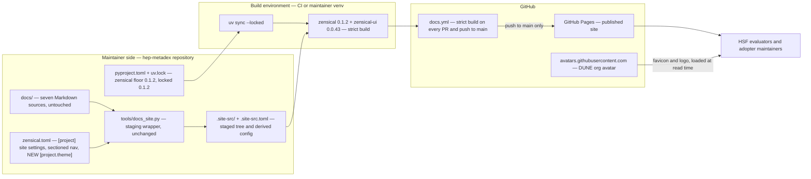

## Context

The **documentation site** publishes today exactly as ADR-0007 delivered it: `zensical.toml` configures Zensical with site settings and a flat seven-page `nav` and no theme section; `tools/docs_site.py` stages `docs/` into `.site-src/`, rewrites out-of-tree links to GitHub URLs, and drives `zensical build --strict` through a derived config; CI (`.github/workflows/docs.yml`) gates every pull request and push on that strict build and deploys to GitHub Pages from `main` only. Zensical is a dev dependency of the **maintainer toolchain**, currently floored `>=0.1.0` and locked to 0.1.0 in `uv.lock`.

Grounding for what follows was verified against the installed Zensical 0.1.0 / zensical-ui 0.0.41 (read from the repo venv), which is the same pair the issue's 2026-11-19 scratch-build exploration verified:

- Zensical maps the whole `[project]` table of `zensical.toml` onto its core config (`config.py:304-305`), so a `[project.theme]` sub-table reaches the `config.theme.*` values the built-in theme's templates read — `palette`, `features`, `favicon`, `logo`. Strict mode rejects unrecognized settings, and the issue's scratch strict build passed with the full candidate config.
- The theme is Material-schema-shaped: palette options carry `media`/`scheme`/`primary`/`accent`/`toggle`, the three toggle icons (`material/brightness-auto`, `brightness-7`, `brightness-4`) ship in the theme's icon set, and palette choice persists via the theme's own `__palette` localStorage — no custom JavaScript.
- Every feature the issue names maps to a real feature flag in the installed templates (none invented).
- Sectioned `nav` entries are dict-with-list values; `tools/docs_site.py`'s derived-config serializer emits nested tables, inline dicts, and quoted keys, so both `[project.theme]` and sectioned `nav` round-trip unchanged.

All twelve ADRs are in force (none supersedes another); ADR-0007 is the live constraint set for this design, ADR-0003 governs how the delta spec validates, and ADR-0006 owns the toolchain the bump lands in.

- Boundaries: everything the change touches sits in the maintainer-side subgraph (one config file plus the lock floor); the wrapper, the CI workflow, and the **workflow scaffolding** adopters copy are untouched.
- Responsibilities: the staging wrapper still owns link rewriting and strict-build invocation; the theme owns all reader-side behavior (palette, instant navigation, layout) from config alone.
- Key relationships: `[project.theme]` flows through the derived config to the builder unchanged; the avatar CDN serves branding to readers at read time, outside the build entirely.
- Assumptions: feature-flag names and template behavior hold on zensical-ui 0.0.43 as verified on 0.0.41 (bug-fix release); apply re-verifies (see Risks).
- Open question: none structural — the diagram's shape is identical before and after this change; only the config file's content differs.

## Goals / Non-Goals

**Goals:**

- Give readers a three-way palette toggle (system → light → dark) with persistence, DUNE branding (favicon + logo), instant in-site navigation, and an audience-sectioned sidebar — entirely via `[project.theme]` and `nav` in `zensical.toml`.
- Raise the Zensical dev dependency to ≥ 0.1.2 and lock it, riding the bug-fix release.
- Keep the strict build green through the staging wrapper with zero invalid links and zero invalid anchors.
- Record the theme and navigation behavior in the `docs-site` delta spec (this change's `specs/docs-site/spec.md`).

**Non-Goals:**

- Any docs-source edit (ADR-0007: docs pages never change for the site's sake); custom CSS, theme overrides, or vendored assets; in-site reference content (glossary, ADRs, specs, change archives — separate follow-up issue); tools API documentation, custom domain, analytics, Zensical Studio.
- Touching the **workflow scaffolding** kit paths or cutting a kit release.

## Decisions

**D1 — All theme settings live in `[project.theme]` of the committed `zensical.toml`.**
One file keeps ADR-0007's hosting-move property meaningful: the settings a hosting move edits stay enumerable in one place. The alternative — a separate theme file or Python-side configuration — does not exist in Zensical's config model and would fracture that property. Verified: `[project]` becomes the core config mapping, so the sub-table reaches `config.theme.*`, and the issue's scratch strict build passed with the candidate config in place.

**D2 — Three-way palette via the theme's triple-option pattern; persistence is built in.**
The palette list carries three options: a media-queried auto option (`media = "(prefers-color-scheme)"`, `brightness-auto` icon), an explicit light option (`scheme = "default"`, `brightness-7`), and an explicit dark option (`scheme = "slate"`, `brightness-4`). The theme's own `__palette` localStorage persists the reader's choice across pages, so no custom JavaScript is introduced. A two-way toggle would violate the issue's three-way rule; hand-rolled toggle scripts are out of scope for a config-only change.

**D3 — Palette colors: primary `indigo`, accent `light-blue`, on both schemes.** *(Delegated decision, recorded.)*
DUNE's brand is a deep blue; among the theme's built-in primary names, `indigo` is the nearest that stays legible in both `default` and `slate`, with `light-blue` as the accent for DUNE-ish highlight contrast. Exact brand hex values would require custom CSS, which config-only scope excludes. Alternatives considered: `blue` (brighter, weaker match to DUNE's navy), `deep-purple` (wrong family). Trivially tunable later by editing two strings.

**D4 — The feature set maps one-to-one onto zensical-ui feature flags.**
Issue feature → flag: navigation footer → `navigation.footer`; instant navigation → `navigation.instant`; instant prefetching → `navigation.instant.prefetch`; automatic previews → `navigation.instant.preview`; reading-progress indicator → `navigation.instant.progress`; anchor tracking → `navigation.tracking`; navigation sections → `navigation.sections`; navigation-path breadcrumbs → `navigation.path`; navigation expansion → `navigation.expand`; navigation pruning → `navigation.prune`; TOC anchor following → `toc.follow`; back-to-top button → `navigation.top`. All twelve exist in the installed templates; none is invented or renamed.

**D5 — Sectioned nav: Home stays top-level; three audience sections follow.** *(Delegated decision, recorded.)*
`nav` keeps `{ "Home" = "index.md" }` as an unsectioned first entry, then nests the issue's example grouping — Getting Started (Setup, Usage), Governance (Governance, HSF Affiliation), Maintainers (Maintainer Guide, Intent Prompt Guidelines) — as dict-with-list values. All titles stay in configuration; no page gains front-matter; the landing page never hides behind a section (and pruning cannot collapse it away). The issue's example grouping is adopted as the final grouping because it matches the site's audiences with no observed conflict.

**D6 — Expand-vs-prune tuning: both flags on, no extra knobs.** *(Delegated decision, recorded.)*
With `navigation.sections` + `navigation.prune`, inactive sections render as single collapsed links while the active section renders expanded (`navigation.expand`); Home and every section link stay permanently visible. On a seven-page site this keeps the sidebar short without making any page more than one click away. `navigation.indexes` is deliberately not enabled — no section index pages exist, and inventing them would require docs-source edits.

**D7 — Branding references the DUNE org avatar by URL; nothing is vendored.**
`favicon` and `logo` both point at `https://avatars.githubusercontent.com/u/7131646?s=200&v=4`, and `zensical.toml`'s header comment is updated to name the three settings a hosting move edits (`repo_url`, `site_url`, the avatar URL). A vendored copy would break the hosting-move property the spec now asserts; the read-time CDN dependency is the accepted trade-off (see Risks).

**D8 — Dependency bump: floor in `pyproject.toml`, re-lock with `uv`.**
`zensical>=0.1.2` in the dev dependency group, `uv lock` to record 0.1.2 (zensical-ui 0.0.43 rides along); CI's `uv sync --locked` picks the pin up with no workflow change.

**D9 — Apply-time verification re-runs on the new pin, and the serializer's pass-through gets a regression test.**
Everything in D1-D7 was verified on 0.1.0/0.0.41; apply must re-run `uv run tools/docs_site.py build` (strict) on 0.1.2 and spot-check the built HTML for the theme markers (palette radio inputs, instant-navigation script, favicon/logo link tags, sectioned sidebar) before merge. A round-trip case in `tools/docs_site_test.py` covering a nested `[project.theme]` table and a sectioned `nav` keeps the wrapper's "every setting it does not derive passes through" behavior guarded. Acceptance-level checks assert built-output markers; reader-runtime behavior (palette persistence, no full page loads) is observed in the rendered HTML/JS the theme ships, since no browser automation exists in this repo's acceptance tooling.

## Risks / Trade-offs

- [0.1.2 / zensical-ui 0.0.43 drifts from the 0.0.41-verified flag names or rendering] -> apply re-runs the strict build and the rendered-HTML spot check on the new pin before merge; a failure surfaces as a strict-build error or a missing marker, not as a silently broken site.
- [Branding depends on `avatars.githubusercontent.com` availability at read time] -> accepted by the issue; degradation is cosmetic (content and navigation unaffected), and the alternative — vendoring the image — would break the hosting-move property.
- [Pruning hides inactive sections' leaf pages behind one click] -> intentional for a seven-page site; Home and section links never prune away, and dropping `navigation.prune` later is a one-line config revert.
- [CI cannot assert reader-runtime behavior (persistence, instant navigation)] -> the strict build plus built-HTML marker checks carry the enforceable weight; the scenarios that describe reader experience are verified against the theme's shipped markup in the built output.
- [Serializer drift if `tools/docs_site.py` is ever changed] -> the D9 round-trip regression test fails loudly.

## Migration Plan

Single pull request on the issue branch: `zensical.toml` (theme section, sectioned nav, header comment), `pyproject.toml` + `uv.lock` (floor and pin), and the change's `specs/docs-site/` delta. No data, no APIs, no coordination: merging to `main` lets `docs.yml` build and publish the modernized site on the next push. Rollback is reverting the merge — the site rebuilds with the previous default-theme config. Reader-side palette state is browser-localStorage only and is ignored by the old theme.

## Open Questions

- None blocking. ADR-0007 is extended rather than revisited: its hosting-move consequence ("edits `repo_url`, `site_url`") widens to include the avatar URL, within the same single-file, infrastructure-event spirit. The `adr` artifact records this as a new decision; no in-force ADR is superseded.
