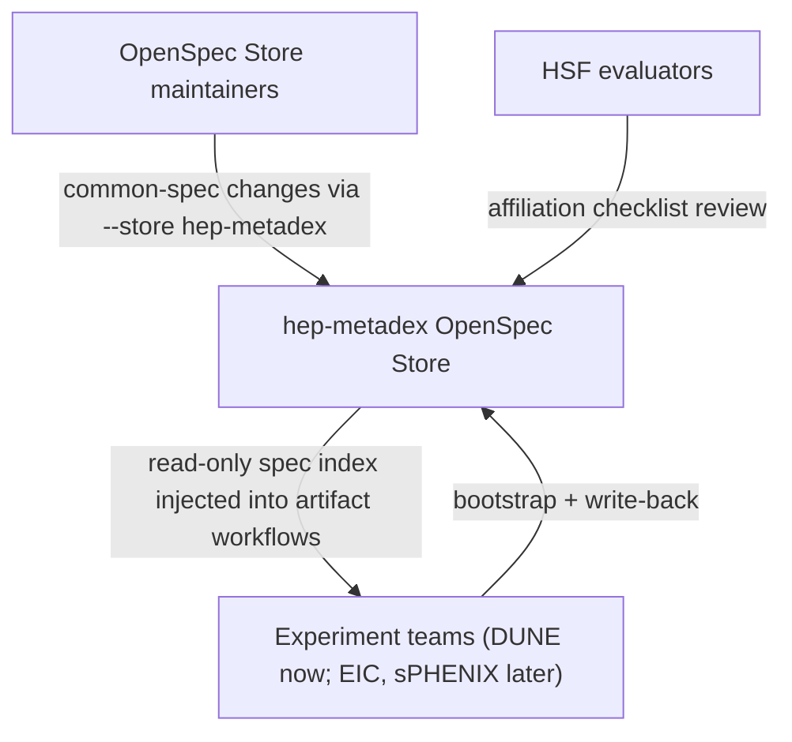
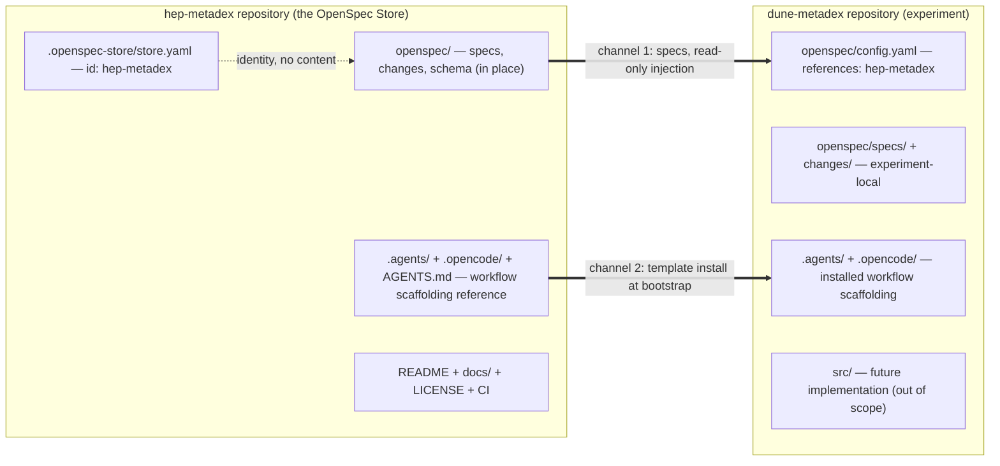

## Context

hep-metadex is a repo-local OpenSpec project: intent-driven schema installed from the intent-driven template, per-stage rules active, zero specs, zero changes, and no repository-level `adr/` directory (verified — no in-force ADRs constrain this design; this change records the first). dune-metadex is a bare README. The project's mandate is to be the general-purpose reference for experiment metadata management systems across high-energy physics, with internal reviews pending and **HSF affiliation** as the adoption path.

The mechanism is OpenSpec Stores (beta, CLI 1.16.0): a standalone OpenSpec repository registered per machine, with read-only `references:` declarations connecting consumer repositories. The **OpenSpec Store**'s layout is documented upstream: `.openspec-store/store.yaml` holds the identity; content stays in the repository's `openspec/` tree. OpenSpec performs no git operations — sharing is ordinary git, and **store references** read whatever is on disk.

Stakeholders: **OpenSpec Store** maintainers (propose **common capability** changes), adopter teams (bootstrap **experiment repositories**), HSF evaluators (walk the affiliation checklist), and AI agents (consume the injected **spec index** during artifact workflows).

## Goals / Non-Goals

**Goals:**
- Convert hep-metadex into a registered **OpenSpec Store** with an **org-neutral** id, additively and in place.
- Bootstrap dune-metadex as the first **experiment repository**: **workflow scaffolding** installed, read-only **Store reference** declared, experiment-local specs and changes.
- Close the HSF checklist gaps: Apache-2.0 license, adopter-facing documentation, spec-validation CI.
- Make a stranger's adoption path documented end to end.

**Non-Goals:**
- The first **common capability** spec (immediate follow-up change — the **OpenSpec Store** launches empty by design).
- Experiment implementation code; EIC/sPHENIX repositories; the HSF application; the HSF-org hosting move.
- Any runtime system (tech stack remains TBD).

## Decisions

### D1: Read-only store references, not the write-routing `store:` line

**Experiment repositories** connect via `references:` in their own `openspec/config.yaml`; they never declare `store:`. Their specs and changes stay local; common-spec improvements route to the **OpenSpec Store** via `--store hep-metadex` on demand.

*Alternatives:* the `store:` line (rejected — routes every experiment change into the central repository; experiments lose their own planning); git submodule/subtree (rejected — merge friction, no agent-context injection); a monorepo (rejected — experiments lose repository and organization independence).

### D2: Two channels — the OpenSpec Store carries specs, the template carries workflow scaffolding

Specs flow through the **OpenSpec Store** (read-only injection); **workflow scaffolding** replicates by template install, with hep-metadex doubling as the template source and its README provenance/divergence manifest as the replication discipline.

*Alternatives:* a separate template repository (deferred — one more repo to govern during incubation; split later if provenance noise demands it); workflow scaffolding distributed through the **OpenSpec Store** (rejected — **store references** inject the **spec index** only, and experiment repos need the kit in their own tree regardless).

### D3: OpenSpec Store identity is additive and org-neutral

`.openspec-store/store.yaml` declares id `hep-metadex`; the existing `openspec/` tree is untouched. The maintainer's development checkout doubles as the registered **OpenSpec Store** (setup registers the creator's copy); adopters clone and register their own. A future hosting move changes only the git remote and the advisory `remote:` line in experiment configs — the id and registrations survive.

*Alternatives:* a fresh **OpenSpec Store** repository with content moved in (rejected — hep-metadex already *is* the content; a move buys nothing); a DUNE-flavored store id (rejected — renames on hosting move).

### D4: Validation gates on `valid: true`; fenced Gherkin is the single scenario source

The bundled validator (CLI 1.16.0) recognizes bullet-style scenario steps; the spec-as-source and acceptance-test tooling mandate fenced Gherkin and hard-require that format. Fenced specs validate as `valid: true` (exit 0), but `--strict` promotes the validator's step-detection warnings to failure. Per the confirmed decision: scenarios are authored once, in fences; CI and the pre-archive check gate on `valid: true`. The acceptance toolchain enforces the same properties the warnings approximate — extraction hard-errors on a scenario without steps, the runner fails on pending or undefined steps, gherkin-lint runs on extracted features.

*Alternatives:* hybrid bullets plus fences (rejected — every scenario maintained in two dialects; a shadow copy the tests never run); bullet-only specs (rejected — abandons spec-as-source, leaving the acceptance extractor nothing to run). *Known issue:* strict-mode compatibility is revisited when a CLI release understands fenced scenarios.

### D5: Apache-2.0, recorded as a deliberate template divergence

The intent-driven template ships MIT; this repository ships Apache-2.0 for its explicit patent grant and contribution terms — appropriate for a cross-institution standards artifact — and records the divergence in the README divergence manifest.

### D6: Spec-validation CI is the HSF "test suite" interpretation

For a zero-runtime repository, a GitHub Actions workflow running `openspec validate` (gating on `valid: true`, per D4) over all specs and changes is the honest reading of the HSF test-suite guideline; the docs map every other checklist item to its satisfying artifact.

### D7: Documentation architecture — adopter front door, org-agnostic throughout

README becomes the adopter quick start; maintainer content (template provenance, divergence manifest, update-from-upstream) is absorbed into `docs/`, never deleted. Governance and contribution text names no organization, so the HSF hosting move is purely infrastructure. The README links stable paths only — a repository-map section pointing at directories and stable filenames (`docs/`, `CONTRIBUTING.md`, `adr/`, `glossary/`, `openspec/specs/`, `openspec/changes/`); per-artifact deep links live in the docs where they carry context (governance → ADR-0002; hsf-affiliation → ADR-0004 and ADR-0001; usage → one archived change as a worked example), so the README never churns as artifacts accumulate.

## Risks / Trade-offs

- [Stores (beta): the CLI surface (commands, flags, file formats) may change] -> pin the CLI version in the adopter docs, provide upgrade guidance, re-read the stores documentation after upgrades, and revisit D4's strict-mode compatibility then.
- [**Store references** read from disk; a stale **OpenSpec Store** checkout silently serves stale specs] -> document pull discipline in `docs/usage.md`; `openspec doctor` checks presence (its pasteable fix carries the declared remote), not freshness.
- [The **OpenSpec Store** launches with zero **common capability** specs] -> expectation set in the proposal and README; dune-metadex proves the adoption mechanism; the first capability is the immediate follow-up change.
- [This change spans two repositories while its artifacts live in one] -> tasks name their target repository; dune-metadex work executes from that repository's own checkout during apply; git discipline applies per repository.
- [Per-machine **OpenSpec Store** registration is a step adopters can miss] -> every experiment config declares the **OpenSpec Store**'s clone URL so `doctor` prints a pasteable clone-and-register fix; the quick start includes registration.
- [Validator warning noise may confuse contributors] -> known-issue note in the docs; CI gates on `valid: true`, so noise never blocks.

## Migration Plan

Additive, ordered, each step a conventional commit on the change branch:

1. Apache-2.0 `LICENSE` + divergence-manifest entry; spec-validation CI (checklist items land first).
2. **OpenSpec Store** conversion: create `.openspec-store/store.yaml`, register the development checkout; verify `openspec doctor` reports the **OpenSpec Store** with valid metadata and `git status` shows no modification to pre-existing `openspec/` paths.
3. dune-metadex bootstrap on its own branch: **workflow scaffolding** install, `openspec/config.yaml` with the **Store reference** (id + clone URL) and experiment context, local `specs/`/`changes/`.
4. Documentation set: README rewrite, `docs/setup.md`, `docs/usage.md`, `docs/governance.md`, `docs/hsf-affiliation.md`, `CONTRIBUTING.md`.
5. Repository-level ADRs (topology, hosting, validation gate, license) via the adr stage; change-local `adr.md` manifest.

*Rollback:* the **OpenSpec Store** conversion is one metadata file — remove it and unregister; the `openspec/` tree was never touched. dune-metadex bootstrap reverts by branch deletion. Documentation and license revert as ordinary commits.

## Open Questions

- **OpenSpec Store conversion mechanics:** does `openspec store setup` convert an existing repo-local root in place, or must `.openspec-store/store.yaml` be created by hand per the documented layout? Verify with a read-only `--help`/dry-run at apply start; hand-creation is the fallback.
- **ADR granularity (adr stage decides):** one ADR covering hosting incubation, the endorsement trigger, and the HSF-hosting follow-on; and whether the D4 validation-gate decision warrants its own ADR or lives here as design context.
- **Acceptance automation for this change:** the scenarios verify via CLI output, `git status`, file existence, and CI results — no runtime application exists for a runner's hooks to boot. Whether to scaffold a full acceptance suite now or verify these scenarios through the validation gate plus scripted CI checks, deferring suite scaffolding until a tech stack exists, is resolved in the tasks stage.
- **First common capability:** out of scope; it is the immediate follow-up change and the **OpenSpec Store**'s first consuming change.
