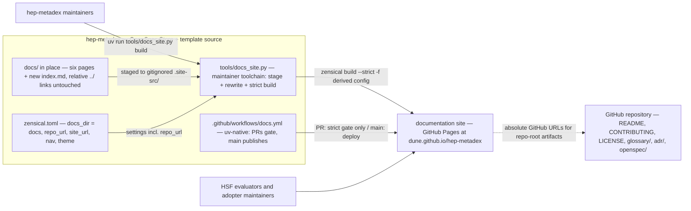

## Context

hep-metadex is a zero-runtime **OpenSpec Store**: **common capability** specs consumed read-only by **experiment repositories**, plus **workflow scaffolding** installed by template. Its documentation — `docs/` with six Markdown pages — is currently readable only as raw Markdown on GitHub. The **HSF affiliation** checklist's documentation guideline expects a highlighted, easy-to-read user's guide; the audience is HSF evaluators and adopter maintainers. The **maintainer toolchain** (Python 3.14 via uv, ADR-0006) exists and reserved a `[dependency-groups]` landing zone for Zensical; this change is that zone's first consumer.

Verified Zensical facts that shape this design: configuration is native `zensical.toml` (`[project]` scope; `site_name` required; `docs_dir` relative and cannot be `.`; `repo_url` renders a repository link and derives view/edit actions); link validation (`invalid_links`, `invalid_link_anchors`) is on by default and validates internal links; `--strict` (or `strict = true`) aborts with exit 1 — the CI gate; `zensical build -f/--config-file` selects an alternate config; explicit `nav` supports titles in config; root-level `index.md` is required and resolves as the homepage. Two hard constraints: Zensical does **not** run arbitrary MkDocs plugins and exposes no plugin/hook API today (a native Module API is roadmap-only), and builds are limited to `docs_dir` plus the config — links escaping `docs_dir` (58 today across the six pages: `../glossary/`, `../adr/`, `../README.md`, `../LICENSE`, `../CONTRIBUTING.md`, `../.github/`, `../openspec/`) fail strict validation as "page does not exist".

In-force ADRs (verified: all six accepted, none superseded): ADR-0001 (two channels — specs read-only through the **OpenSpec Store**, **workflow scaffolding** by template install), ADR-0002 (DUNE incubation with HSF-endorsement trigger; governance text **org-neutral**), ADR-0003 (fenced Gherkin single source; `valid: true` non-strict spec-validation gate), ADR-0004 (Apache-2.0 as a recorded divergence), ADR-0005 (validate.yml distributed as host-conditional scaffolding), ADR-0006 (Python 3.14 + uv **maintainer toolchain**, repo-local non-channel; uv unpinned with the lockfile as anchor, pinning revisited "when its CI installs uv explicitly" — this change's CI is that trigger). This design extends ADR-0001 and ADR-0006 with a new repo-local non-channel (the site tooling), revisits no in-force ADR, and leaves the spec-validation gate untouched.

Stakeholders: HSF evaluators and adopter maintainers (site readers), hep-metadex maintainers (site builders), and CI (the enforcing boundary).

- Boundaries: the site tooling is repo-local, like the **maintainer toolchain** — it flows through neither of ADR-0001's channels and appears on no adopter copy-list; the **workflow scaffolding** (including `validate.yml`) is untouched.
- Responsibilities: `tools/docs_site.py` owns staging and link rewriting; the committed `zensical.toml` owns every site setting, with `repo_url` as the single repo-URL setting; the workflow owns the CI gate and deployment.
- Key relationships: docs sources are never edited for the site's sake — the transformation happens in the gitignored staging copy; the published site points readers at repo-root artifacts via absolute GitHub URLs.
- Assumptions: Zensical resolves on Python 3.14 (ADR-0006 chose 3.14 partly because it matches Zensical's documented example; the spike verifies); GitHub Pages serves the project subpath with `site_url` set to the exact Pages URL.
- Open question: Zensical's Module API (roadmap) would let the staging pass collapse into a native in-build module — a recorded revisit trigger, not a blocker.

## Goals / Non-Goals

**Goals:**
- Publish `docs/` in place as a Zensical-built **documentation site** on GitHub Pages: push to `main` builds `zensical build --strict` and deploys; pull requests run the same strict build and never publish.
- Resolve all 58 out-of-tree links on the published site as absolute GitHub URLs derived from one config setting, with docs sources keeping their relative links (**org-neutral**, GitHub-friendly).
- Land Zensical as a pinned uv dev dependency (ADR-0006's reserved `[dependency-groups]`); close ADR-0006's uv-pinning open question by pinning uv in the CI that installs it.
- Upgrade the HSF checklist's Documentation row with the live site URL, with the org-agnostic governance requirement scoped for factual hosting citations (the `governance-docs` delta).
- Record the durable decisions and the uv symlink `link-mode` caveat in ADR-0007.

**Non-Goals:**
- Glossary/ADR site migration (in-site inclusion) — a candidate follow-up change; custom domain, analytics, blog, Zensical Studio; acceptance-test scaffolding (tracked in #20); runtime code.
- Any edit to the **workflow scaffolding**, `validate.yml`, the spec-validation gate, or the README quick start.
- Any docs-source rewrite to absolute URLs (rejected: it would break the org-agnostic governance guarantee on a hosting move).

## Decisions

### D1: Native `zensical.toml` with `docs_dir = "docs"` — the committed config is the project config
The committed `zensical.toml` sets `site_name`, `site_url` (the exact Pages URL), `repo_url`, `docs_dir = "docs"`, `site_dir`, explicit `nav` with titles, a minimal built-in theme, and `strict = true` (local `zensical serve` and non-strict builds read this config directly; out-of-tree links warn but do not block preview). The strict publishing build uses a derived config (D2), so the deliverable — `docs_dir` pointing at `docs/` in place — is what the repository's one committed config says.

*Alternatives:* the `mkdocs.yml` compatibility format (rejected — the issue recommends native, and native is the format Zensical documents and evolves); `docs_dir = "."` (unsupported by Zensical today); pointing the committed config at the staging tree (rejected — breaks the deliverable and makes plain `serve` depend on a prior staging run).

### D2: Out-of-tree links are resolved by a staging pass — `tools/docs_site.py`, not a plugin
A stdlib-only maintainer-toolchain script stages `docs/` into gitignored `.site-src/`, rewriting every `../`-escaping relative link (preserving `#anchor` fragments) to `{repo_url}/blob/main/{path}` — uniformly for all out-of-tree targets, not only the issue's enumerated set. It then writes a derived config (settings loaded from the committed `zensical.toml`, `docs_dir` swapped to the staging tree) and invokes `zensical build --strict --config-file <derived>`. Subcommands: `build` (CI and publishing) and `serve` (stage, then preview the staged tree). The rewrite runs before validation by construction — the staged tree contains only rewritten links, so out-of-tree links pass strict as external links and every in-tree link and anchor is still validated.

*Alternatives:* a Zensical hook/plugin (unavailable — Zensical runs no arbitrary plugins and has no hook API; the Module API is roadmap-only); editing docs sources to absolute URLs (rejected in grilling — hardcodes the org across governance documents, breaking the hosting-move guarantee); in-site inclusion via symlink or copy (rejected for v1 — symlinks out of `docs_dir` are not followed, and inclusion is the follow-up change); setting `invalid_links = false` (rejected — it disables exactly the gate the issue requires); waiting for the Module API (rejected — blocked on an external roadmap with no date).

### D3: `repo_url` is the single repo-URL setting
The rewrite base is Zensical's first-class `[project] repo_url` — the same setting that renders the theme's repository link. A hosting move edits `repo_url` and `site_url` in `zensical.toml` plus the checklist's factual hosting citations (per the `governance-docs` delta); no docs source changes. No custom `[project.extra]` key is introduced.

*Alternatives:* a custom config key (rejected — duplicates a first-class setting); deriving the URL from the git remote at build time (rejected — the config file is the single readable, reviewable source, and CI checkouts may carry odd remotes).

### D4: A uv-native `docs.yml` workflow — PRs gate, `main` publishes, uv pinned
`.github/workflows/docs.yml` (separate from the adopter-copied `validate.yml`, not added to any copy-list) triggers on `pull_request` and `push` to `main` (plus `workflow_dispatch` for manual republish from `main`). Both paths: checkout, `astral-sh/setup-uv` with an explicitly pinned uv version (closing ADR-0006's open question — a CI-installed uv makes the pin testable), `uv sync --locked` (uv manages the pinned 3.14 interpreter; no `setup-python`), then the staging build via `tools/docs_site.py build`, which runs `zensical build --strict`. The `main` path additionally uploads `site/` via `actions/upload-pages-artifact` and deploys with `actions/deploy-pages` under `permissions: contents: read, pages: write, id-token: write` and the `github-pages` environment. No CI caching (Zensical's current guidance recommends against it). A one-time administrative precondition — Pages enabled with the GitHub Actions publishing source — precedes the first deploy and is carried as a task.

*Alternatives:* adapting Zensical's shipped `docs.yml` verbatim (rejected — it installs Zensical with pip outside the lockfile, exactly what the uv-native choice avoids); branch-based Pages publishing (rejected — artifact-based deploys from Actions are the documented, atomic path); leaving uv unpinned in CI (rejected — ADR-0006 deferred the pin only until a CI installed uv explicitly, which this workflow does).

### D5: `docs/index.md` landing page; explicit nav with config-side titles
A new `docs/index.md` orients the site audience: what hep-metadex is (an **OpenSpec Store** plus **workflow scaffolding**), paths for adopters (setup, usage), evaluators (governance, HSF affiliation), and contributors (the GitHub repository), linking out via the same relative links every other page uses. Explicit `nav` in `zensical.toml` lists `index.md` plus all six existing pages — Home, Setup, Usage, Governance, HSF Affiliation, Maintainer Guide, Intent Prompt Guidelines — with titles in config, so no existing page gains front-matter or content edits for navigation or theming.

*Alternatives:* a README-derived index (rejected in grilling — the README is the repo front door written for cloners, not site readers); auto-generated nav from filenames (rejected — an explicit list is the contract that no page is silently dropped).

### D6: The checklist row lands as a factual hosting citation; the divergence row records the tooling
`docs/hsf-affiliation.md`'s Documentation row cites the live site URL alongside the README and `docs/` citations — an absolute URL that changes on a hosting move, which is why the `governance-docs` delta scopes the org-agnostic requirement (processes stay **org-neutral**; factual hosting citations are exempt infrastructure facts, recorded in ADR-0007). Bookkeeping follows the #21 precedent: one divergence-manifest row for the site tooling (`zensical.toml`, `tools/docs_site.py`, `.github/workflows/docs.yml`) as repo-local files the template never ships, and one README repository-map row so maintainers discover them; the **documentation site** glossary term lands in `glossary/technical.md`.

*Alternatives:* recording the site URL without the org-agnostic scoping (rejected — the delta would contradict the spec it modifies); skipping the manifest row (rejected — governance.md's review bar requires recording deliberate template divergences).

### D7: ADR-0007 records the durable set
One durable ADR: Zensical on GitHub Pages; native `zensical.toml`; uv-native workflow with pinned uv; out-of-tree links via staging rewrite to absolute GitHub URLs (with the rejected alternatives and the Module API revisit trigger); the factual-citation scoping of the org-agnostic governance requirement; and consequences including the staging-pass maintenance cost and the uv symlink `link-mode` caveat the issue names.

## Risks / Trade-offs

- [The staging + derived-config approach hits an undocumented Zensical constraint] -> the first apply step is a vertical spike: stage one page, rewrite one link, build strict against the derived config — green before any other work; if red, the fallback is a committed build config pointing at the staging tree, adopted only after the change artifacts consciously amend the `docs_dir` deliverable.
- [Zensical's validator behaves differently than documented for rewritten links] -> covered by the same spike; the strict build over the fully staged tree is the acceptance check, and the 58-link rewrite is verifiable by diffing staged output.
- [Python 3.14 does not resolve for Zensical] -> `uv add --dev zensical` fails loudly in the spike; ADR-0006 anticipated 3.14 as the documented example — a failure triggers a deliberate pin decision rather than a silent downgrade.
- [uv's default cache link mode (hardlinks/symlinks) misbehaves on network or exotic local filesystems] -> CI on `ubuntu-latest` is unaffected; local maintainers set `UV_LINK_MODE=copy` when needed; recorded as a consequence in ADR-0007 per the issue.
- [Plain `zensical serve` previews the unstaged tree with 58 warnings and dead out-of-tree links] -> `tools/docs_site.py serve` previews the staged (rewritten) tree; the wrapper is the documented path, and the warnings on plain serve are known-issue noise, not failures.
- [The site could drift from the repository's docs] -> it cannot: every build stages from `docs/` in place on every PR and push; there is no second documentation source.
- [Pages subpath serving breaks anchors or canonical URLs] -> `site_url` is set to the exact Pages URL; first-deploy verification walks the site including anchored links.

## Migration Plan

Ordered apply-phase steps, each a conventional commit carrying the `(#22)` subject suffix. All are code-zone (outside `openspec/`); the specs-zone deltas are complete and merged before apply per the git discipline.

1. Spike (folded into step 3's commit): `uv add --dev zensical`; verify Python 3.14 resolution; stage one page and one rewritten link; strict build green against the derived config.
2. `build(docs): pin zensical as a dev dependency (#22)` — `[dependency-groups]` entry plus `uv.lock`.
3. `feat(docs): add the staging build entry point for the docs site (#22)` — `tools/docs_site.py` (build/serve), `.gitignore` gains `site/` and `.site-src/`; spike verified.
4. `docs(site): add zensical.toml with in-place docs_dir, navigation, and theme (#22)` — committed config per D1/D3/D5.
5. `docs(site): add the site landing page (#22)` — `docs/index.md` per D5.
6. `ci(docs): add the uv-native build-and-publish workflow (#22)` — `.github/workflows/docs.yml` per D4.
7. Operational (no commit): a repository admin enables GitHub Pages with the GitHub Actions publishing source.
8. `docs(governance): cite the live site in the HSF checklist documentation row (#22)` — the hsf-affiliation row per D6.
9. `docs(maintainer): record the docs-site tooling divergence and map row (#22)` — manifest row plus README repository-map row per D6.
10. `docs(glossary): add the documentation site term (#22)` — `glossary/technical.md` per D6.
11. `docs(adr): record ADR-0007 zensical docs site publishing (#22)` — durable ADR per D7.
12. Verification: a PR with docs edits shows the strict docs gate green and publishes nothing; after merge, the site is live at the Pages URL with all seven pages navigable; out-of-tree links resolve on GitHub; `git diff` shows no docs-source link edits beyond `docs/index.md` and the checklist row; `openspec validate --all` stays `valid: true`.

*Rollback:* every step reverts as an ordinary commit; reverting steps 2–6 removes the site machinery entirely; disabling Pages (optional) removes the published artifact. Nothing touches stored specs until the archive-time sync.

## Open Questions

- **Module API revisit trigger (adr stage records):** when Zensical's native Module API ships publicly, the staging pass (D2) can collapse into an in-build module; ADR-0007 carries this as an explicit revisit condition, not a dependency.
- **Acceptance automation (tasks stage):** the delta scenarios verify at the CI boundary (the strict docs gate) and the published site; the acceptance runner itself is deliberately deferred to #20 per the issue, and the task list orders work so each scenario's observable lands with its implementation.
- **Pre-existing and out of scope:** the `governance-docs` spec's "Spec-validation CI" scenarios say "strict validation" where ADR-0003 gates non-strict — flagged in the prior change's design, unchanged here, and left for a separate small alignment change.
